# Muse MCP Adapter: connect MCP servers to Muse, on your terms

<p>
<a href="docs/README.md"></a>
<a href="docs/connect-github-to-muse.md"></a>
<a href="docs/chat-setup.md"></a>
<a href="docs/security.md"></a>
<a href="docs/design.md"></a>
<a href="https://modelcontextprotocol.io"></a>
<a href="LICENSE"></a>
</p>

**A self-hosted gateway that lets Muse use your [MCP](https://modelcontextprotocol.io) (Model Context Protocol) servers, such as GitHub, Linear or Atlassian, as a Custom Connector, with only the access you approved.** Tell Muse what you want in a sentence. It drafts the smallest policy that does the job, you approve it on a page of your own with your owner password, and access widens one operation at a time as real tasks need it. Your credentials never reach Muse, and a write runs once or says it may not have.

[Get started](#get-started) · [Connect GitHub to Muse](docs/connect-github-to-muse.md) · [How it works](docs/how-it-works.md) · [FAQ](#faq) · [All documentation](docs/README.md)

<p align="center">
  
</p>

## What is it?

MCP is how applications such as code hosts, issue trackers, wikis and databases publish tools and data to AI agents. Muse is a personal AI agent that adds services through Custom Connectors, which it reads from an OpenAPI description. An MCP server can be added to Muse as a Custom Connector directly, but doing that one server at a time repeats protocol, authentication, policy and change-tracking work for each one, and gives you few ways to say *this much and no more*.

The adapter does that work once. Toward Muse it is an ordinary REST API with an OpenAPI description, so Muse adds it in chat like any connector. Toward the MCP server it is a careful MCP client. In between it applies your rules, with your credentials, on a machine you run. [More on how it works](docs/how-it-works.md).

## Connect a server by chatting with Muse

You add **one** connector to Muse by hand, once: the adapter's setup connector. After that, new servers are a conversation.

<p align="center">
  
</p>

1. **You say what you want.** Muse is told not to guess tool names. It sends the service and your words, and exact names only if it already knows them.
2. **You connect.** On your own page you type the owner password and give the service token. The adapter reads what the service offers and freezes it as an immutable, hashed snapshot: the service's truth.
3. **Muse drafts the policy.** It reads the full details and picks the smallest set of operations that does what you asked, with a short reason for each. A deterministic compiler only checks exact names against the snapshot, so a wrong or misled draft can never reach beyond what the service really offers and what you approve.
4. **You approve a summary, with your owner password.** Operations that change data come first. Approving always asks for the password again, so a page left open or a driven browser cannot add access.
5. **Access starts small and widens one operation at a time.** When a task needs something that is not allowed, Muse asks for just that operation, with a reason, and you approve it the same way. Making access smaller (turning an operation off, adding a limit or an end time, disconnecting) needs no approval, because it can only reduce what Muse can do.

[The full flow, with the security reasoning](docs/chat-setup.md) · [Connect GitHub to Muse, step by step](docs/connect-github-to-muse.md)

## Every call is checked

<p align="center">
  
</p>

## Why use it?

- **Your policy, drafted for you and approved by you.** No long list of tools to tick. Muse drafts from the service's real details, you approve what changes data, and the adapter enforces it on every call.
- **A stable, reviewed contract.** What Muse may use is frozen when you publish it. A later change at the MCP server never silently changes it: you see the difference, publish a new version, or roll back.
- **Limits on values and time.** Hold an operation to one repository or project, and make access end by itself after a few hours.
- **Writes that run once.** A repeated write is never run twice, and when the outcome is unknown the adapter blocks a blind retry until you have checked.
- **The whole of MCP, tested.** Tools, resources, prompts, structured and multimedia results, progress, and mid-call questions are carried into one REST contract and validated against a purpose-built server.
- **You keep custody.** You host it, keep the credentials, and keep the audit trail, a hash chain that shows edits and removals. Muse holds one revocable token per connector.

**What Muse already does, and what this adds.** Muse can add services as Custom Connectors, keeps credentials away from the agent, confirms consequential actions with you, and keeps an activity history. The adapter does not replace any of that. It adds a layer you own, between Muse and each server:

| When this happens | Connecting each server by hand | Through the adapter |
| --- | --- | --- |
| You want Muse to use a service, but not all of it | You pick from whatever the connector offers | Muse drafts the smallest policy from the service's real details; you approve it with a password |
| A task needs more than was approved | Broader access is granted up front | One operation at a time, each approved by you |
| A server adds, removes or changes a tool | Muse follows the change at once, reviewed or not | The published contract stays fixed. You see what changed, then publish a new version or roll back |
| A write times out and nobody knows if it happened | Nothing records the attempt, so a retry can do it twice | The write is recorded. A repeat is replayed, and an unknown outcome blocks a blind retry |
| You use more than a server's tools: resources, prompts, progress, questions mid-call | It depends on the connector you build | All carried into one REST contract and tested against a direct MCP client |
| You must say where credentials and audit records live | Wherever the platform keeps them | On a machine you run |

[What it adds in detail, with the tests behind each claim and where it stops](docs/what-it-adds.md).

The trade-off is one more service to run. For a single simple, stable MCP server you may not need it. It pays off with several servers behind one reviewed boundary, with access you want to keep small, or when a write must never be done twice.

## Get started

You need a computer with Python 3.12+ and `ssh`, a free [Tailscale](https://tailscale.com) account, and a place to run the adapter: a Google Cloud project (with `gcloud` signed in), a Linux machine you can SSH into, or the Linux VM itself.

```bash
pipx install git+https://github.com/sept-usc/muse-mcp-adapter
muse-vm setup --chat-setup
```

On Google Cloud with nothing installed locally: [](https://shell.cloud.google.com/cloudshell/editor?cloudshell_git_repo=https://github.com/sept-usc/muse-mcp-adapter.git&cloudshell_tutorial=docs/cloudshell-tutorial.md&cloudshell_workspace=.)

`muse-vm setup` takes about 5 to 10 minutes. It asks where to run the adapter, builds and starts it, and gives it a public HTTPS address through Tailscale Funnel with nothing open on the machine. You click one Tailscale sign-in link. It is safe to run again if anything stops half way. At the end it prints, once each, a sentence to give Muse with a token, and your **owner code**.

1. **Add the one connector by hand.** In a new Muse chat, send the sentence, click **Connect**, and paste the token into Muse's own secure field.
2. **Choose your owner password** (optional, recommended): `muse-vm chat-setup --set-owner-password`. It replaces the generated code. You type it only on your adapter's own review pages, never into Muse.
3. **Ask Muse.** For example: *"Connect my GitHub repository OWNER/REPO. Read, commit, open pull requests and create issues, but nothing that deletes. Three hours."* Follow the link Muse gives you.

**Prefer the command line?** `muse-vm setup` without `--chat-setup` lets you pick servers in the terminal instead, and `muse-vm add-server NAME` adds one later. Then, in a new Muse chat: *"Create a connector called GitHub from the API spec at `<the address setup printed>`"*, click **Connect** and paste the token.

**Next:** [full setup guide](docs/getting-started.md) · [install from the VM itself](docs/getting-started.md#installing-from-the-vm-itself) · [settings file, Terraform and automation](docs/automation.md) · [something went wrong](docs/troubleshooting.md)

## FAQ

**How do I connect an MCP server to Muse?** Put the adapter between them. Muse adds the adapter as a Custom Connector, and the adapter speaks MCP to your server. With chat setup you ask Muse for the server and approve it on your own page. [How](docs/chat-setup.md).

**How do I give Muse access to my GitHub repository safely?** Create a fine-grained GitHub token limited to one repository, give it to the adapter on its review page (never to Muse), and approve only the operations the task needs. [Step by step](docs/connect-github-to-muse.md).

**Does Muse ever see my GitHub or Linear token?** No. The token is typed on the adapter's page, stored encrypted on your machine, and used only by the adapter. Muse holds one revocable connector token that works on its own connector only. [Every credential](docs/authentication.md).

**Can Muse widen its own access?** No. The setup connector has no operation that publishes, activates or widens anything, and approving always needs your owner password. Narrowing is the only thing it can do alone. [Why](docs/chat-setup.md#why-muse-cannot-widen-its-own-access).

**Which MCP servers work?** Any remote MCP server over Streamable HTTP, including one you wrote. About 34 well-known services (Linear, GitHub, Atlassian, Sentry, Notion, Slack, Stripe, Supabase and others) can be named in chat with no address. [The list and how each signs in](docs/chat-setup.md#which-services-muse-can-look-up-by-name).

**Do I need to run a server?** Yes, a small one that you own: a Google Cloud VM that `muse-vm` creates, or any Linux machine. There is no shared service in the middle.

**What does it not do?** It does not run local `stdio` servers, render MCP Apps, or limit what Muse does with its other tools such as its own browser. [The honest list](docs/what-it-adds.md#what-it-does-not-do-yet).

## Use it

| I want to | Go to |
| --- | --- |
| Connect GitHub to Muse with a scoped token | [Connect GitHub to Muse](docs/connect-github-to-muse.md) |
| Add servers by chatting with Muse, approving on a page | [Set up by chat](docs/chat-setup.md) |
| Add a server, change what Muse can use, back up, upgrade, rotate a token | [Day to day](docs/day-to-day.md) |
| Let Muse make changes, not just read | [Letting Muse change things](docs/getting-started.md#letting-muse-change-things) |
| Decide exactly what Muse can use | [Your policy](docs/policy.md) |
| Try the whole flow yourself, on your computer and then as a customer would | [Test it yourself](docs/test-locally.md) |
| See what the API looks like to Muse | [What Muse sees](docs/api.md) |
| Fix a problem | [Troubleshooting](docs/troubleshooting.md) |

## Learn more

The [documentation index](docs/README.md) lists every page. The main ones:

| Topic | Page |
| --- | --- |
| What it adds, with the evidence and the limits | [What it adds](docs/what-it-adds.md) |
| How it works, and the key terms | [How it works](docs/how-it-works.md) |
| Every command and what is installed on the machine | [Deployment reference](docs/deployment.md) |
| Looking after it | [Running on a VM](docs/operations.md) |
| Every credential and how it is protected | [Identity and authentication](docs/authentication.md) |
| What is public and what is private | [Network exposure](docs/networking.md) |
| Controls and guarantees | [Security model](docs/security.md) and [security policy](SECURITY.md) |
| Configuration, policy reference, API | [Usage guide](docs/usage.md) |
| How parity with a direct MCP connection is tested | [Validation guide](docs/validation.md) |
| How it is built | [System design](docs/design.md), [control plane](docs/control-plane.md), [data plane](docs/data-plane.md) |
| Running it without `muse-vm`, and the provider packs | [Run it by hand](docs/run-by-hand.md) |
| Contributing | [Contributing](CONTRIBUTING.md) |

## Scope

**Supported:** remote MCP servers over Streamable HTTP; tools, resources, resource templates, and prompts; progress and log messages, questions asked mid-call, and image, audio, and linked content; no credential, a static token, or OAuth to the MCP server.

**Not included:** local `stdio` servers, MCP Apps rendering, a hosted marketplace, or billing. Each deployment serves one owner.

**What the policy covers:** what passes through the adapter. A tool the adapter does not publish cannot be called through it, but the policy does not limit what Muse can do with its other tools, such as its own browser; limit those in Muse.

## License

Released under the [MIT License](LICENSE). Copyright (c) 2026 SEPT Lab, University of Southern California.
