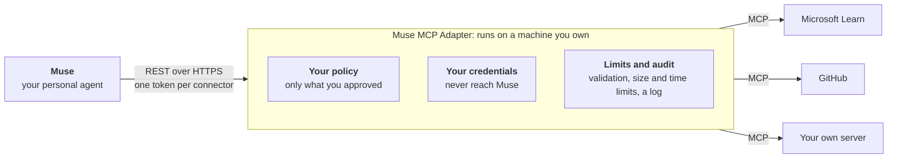

# Muse MCP Adapter

**A boundary you control between Muse and your MCP servers.** The adapter publishes only the capabilities you have reviewed, keeps the credentials for your MCP servers to itself, holds that contract steady as servers change, and makes sure a write runs once or says it may not have. One guided command sets it up on a machine you own.

[Get started](#get-started) · [How it works](docs/how-it-works.md) · [Troubleshooting](docs/troubleshooting.md) · [All documentation](#learn-more)



## What is it?

[MCP](https://modelcontextprotocol.io) (Model Context Protocol) is how applications such as issue trackers, wikis, and databases publish tools and data. Muse is a personal AI agent that adds services through Custom Connectors, which it reads from an OpenAPI description. An MCP server can be added to Muse as a Custom Connector, but doing that one server at a time duplicates protocol, authentication, policy, and change-tracking work for each one.

The adapter does that work once. Toward Muse it is an ordinary REST API with an OpenAPI description, so Muse adds it in chat like any connector. Toward the MCP server it is a careful MCP client. In between it applies your rules. [More on how it works](docs/how-it-works.md).

## Why use it?

- **A stable, reviewed contract.** What Muse may use is frozen when you publish it. A later change at the MCP server never silently changes it: you see the difference, publish a new version, or roll back.
- **Your policy, enforced by a system you run.** You decide which operations exist for Muse and whether each is a read, a write, or a sensitive write.
- **Writes that run once.** A repeated write is never run twice, and when the outcome is unknown the adapter blocks a blind retry until you have checked.
- **The whole of MCP, tested.** Tools, resources, prompts, structured and multimedia results, progress, and mid-call questions are carried into one REST contract and validated against a purpose-built server.
- **You keep custody.** You host it, keep the credentials, and keep the audit trail. Muse holds one revocable token per connector.

**What Muse already does, and what this adds.** Muse can add services as Custom Connectors, keeps credentials away from the agent, confirms consequential actions with you, and keeps an activity history. The adapter does not replace any of that. It adds a layer you own, between Muse and each server:

| When this happens | Connecting each server by hand | Through the adapter |
| --- | --- | --- |
| A server adds, removes or changes a tool | Muse follows the change at once, reviewed or not | The published contract stays fixed. You see what changed, then publish a new version or roll back |
| Someone must limit what the agent can do | Limits are whatever the agent platform offers | A second policy, owned by whoever owns the system, applied to every call |
| A write times out and nobody knows if it happened | Nothing records the attempt, so a retry can do it twice | The write is recorded. A repeat is replayed, and an unknown outcome blocks a blind retry |
| You use more than a server's tools: resources, prompts, progress, questions mid-call | It depends on the connector you build | All carried into one REST contract and tested against a direct MCP client |
| You must say where credentials and audit records live | Wherever the platform keeps them | On a machine you run |

[What it adds in detail, with the tests behind each claim and where it stops](docs/what-it-adds.md).

The trade-off is one more service to run. For a single simple, stable MCP server you may not need it. It pays off with several servers behind one reviewed boundary, or when a write must never be done twice.

## Get started

You need a computer with Python 3.12+ and `ssh`, a free [Tailscale](https://tailscale.com) account, and a place to run the adapter: a Google Cloud project (with `gcloud` signed in), a Linux machine you can SSH into, or the Linux VM itself.

```bash
pipx install git+https://github.com/sept-usc/muse-mcp-adapter
muse-vm setup
```

On Google Cloud with nothing installed locally: [](https://shell.cloud.google.com/cloudshell/editor?cloudshell_git_repo=https://github.com/sept-usc/muse-mcp-adapter.git&cloudshell_tutorial=docs/cloudshell-tutorial.md&cloudshell_workspace=.)

`muse-vm setup` takes about 5 to 10 minutes. It asks where to run the adapter, builds and starts it, and gives it a public HTTPS address through Tailscale Funnel with nothing open on the machine. You click one Tailscale sign-in link, pick your MCP servers, and paste a token for any that need one. It is safe to run again if anything stops half way.

Then, in a new Muse chat, say: *"Create a connector called GitHub from the API spec at `<the address setup printed>`"*, click **Connect**, and paste the token. That's it.

**Next:** [full setup guide](docs/getting-started.md) · [install from the VM itself](docs/getting-started.md#installing-from-the-vm-itself) · [settings file, Terraform and automation](docs/automation.md) · [something went wrong](docs/troubleshooting.md)

## Use it

| I want to | Go to |
| --- | --- |
| Add a server, change what Muse can use, back up, upgrade, rotate a token | [Day to day](docs/day-to-day.md) |
| Let Muse make changes, not just read | [Letting Muse change things](docs/getting-started.md#letting-muse-change-things) |
| Decide exactly what Muse can use | [Your policy](docs/policy.md) |
| See what the API looks like to Muse | [What Muse sees](docs/api.md) |
| Fix a problem | [Troubleshooting](docs/troubleshooting.md) |

## Learn more

| Topic | Page |
| --- | --- |
| What it adds, with the evidence and the limits | [What it adds](docs/what-it-adds.md) |
| How it works, and the key terms | [How it works](docs/how-it-works.md) |
| Every command and what is installed on the machine | [Deployment reference](docs/deployment.md) |
| Looking after it | [Running on a VM](docs/operations.md) |
| Every credential and how it is protected | [Identity and authentication](docs/authentication.md) |
| What is public and what is private | [Network exposure](docs/networking.md) |
| Controls and guarantees | [Security model](docs/security.md) and [security policy](SECURITY.md) |
| Configuration, policy reference, API | [Usage guide](docs/usage.md) |
| How parity with a direct MCP connection is tested | [Validation guide](docs/validation.md) |
| Holding risky actions until you approve them | [Owner approval](docs/owner-approval.md) |
| Controlling what of your data reaches the agent | [Sealed values](docs/sealed-values.md) |
| What changes when an agent goes through the adapter, shown side by side | [Trust lab](docs/trust-lab.md) |
| How it is built | [System design](docs/design.md), [control plane](docs/control-plane.md), [data plane](docs/data-plane.md) |
| Running it without `muse-vm`, and the provider packs | [Run it by hand](docs/run-by-hand.md) |
| Contributing | [Contributing](CONTRIBUTING.md) |

## Scope

**Supported:** remote MCP servers over Streamable HTTP; tools, resources, resource templates, and prompts; progress and log messages, questions asked mid-call, and image, audio, and linked content; no credential, a static token, or OAuth to the MCP server.

**Not included:** local `stdio` servers, MCP Apps rendering, a hosted marketplace, or billing. Each deployment serves one owner.

**What the policy covers:** what passes through the adapter. A tool the adapter does not publish cannot be called through it, but the policy does not limit what Muse can do with its other tools, such as its own browser; limit those in Muse.

## License

Released under the [MIT License](LICENSE). Copyright (c) 2026 SEPT Lab, University of Southern California.
