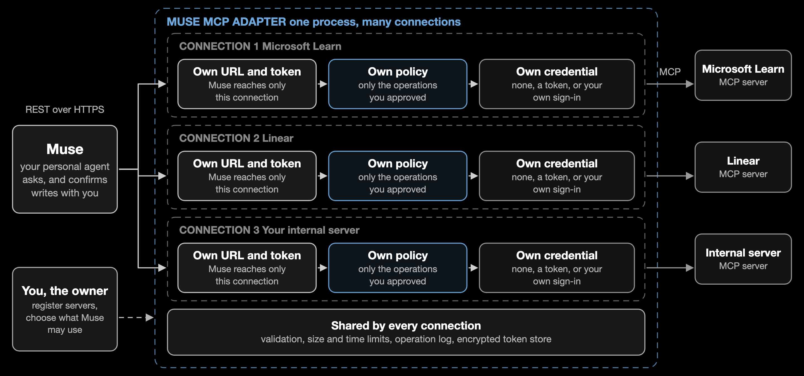
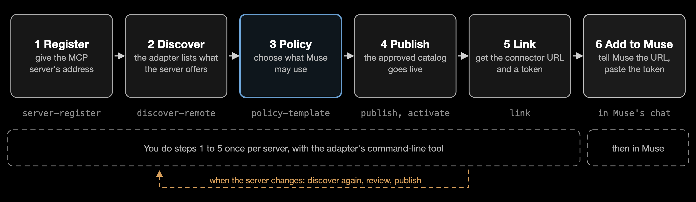
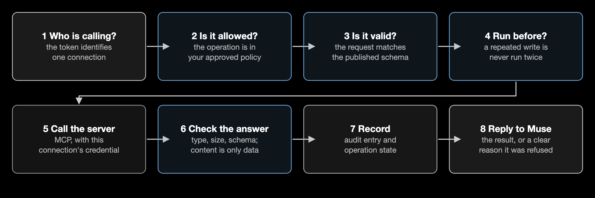

# Muse MCP Adapter

**Let Muse use any MCP server, safely.** The adapter sits between Muse and the MCP servers you rely on. It shows Muse only what you approve, keeps your credentials to itself, and makes sure a write runs once or says it may not have.



## What is it?

[MCP](https://modelcontextprotocol.io) (Model Context Protocol) is how applications such as issue trackers, wikis, documentation sites, and databases publish tools, data, and prompt templates. Muse is a personal AI agent that adds services through Custom Connectors, which it reads from an OpenAPI description. Muse does not speak MCP, so MCP servers are out of its reach.

The adapter bridges the two:

- **Toward Muse** it is an ordinary REST API with an OpenAPI description. Muse adds it in chat like any custom connector.
- **Toward the MCP server** it is a careful MCP client, so the server sees a normal MCP conversation.
- **In between** it applies your rules: what is exposed, what counts as a read or a write, and the limits on each call.

For Muse it behaves almost like a transparent wrapper: using a server through the adapter is as good as talking to the MCP server directly, and the few differences are deliberate and visible.

## What can you use it for?

- **Look things up from Muse.** Connect a documentation or knowledge server, such as Microsoft Learn, and Muse can search official documentation and read whole pages while you chat. Ask "How do I raise the function timeout for Azure Functions on the Consumption plan?" and Muse searches, then answers from the real documentation.
- **Work with your tools through chat.** Connect an issue tracker, a wiki, or a database server, such as Linear or Atlassian, so Muse can read records and, with your confirmation, change them. Every write is marked, confirmed with you first, and runs once.
- **Share only part of a server.** A server may offer dozens of tools. Publish just the read-only ones, or just the three you need, and the rest do not exist for Muse.
- **Bring your own MCP servers to Muse.** Any MCP server, including one you wrote, becomes a Muse connector. You do not hand-write an API description or build a separate connector for each tool.
- **Keep credentials out of Muse.** Muse holds one revocable token per connector. The keys and sign-ins for the MCP servers stay inside the adapter.
- **Stay in control as servers change.** When a server adds, removes, or alters a tool, you see the difference and decide whether Muse gets it.
- **See what Muse did.** Every call is recorded with its operation, outcome, and duration, and a write's state is tracked until it is settled.

## Why do you need it?

MCP servers change on their own: tools appear, schemas shift, and a tool marked "read-only" may not be. Connecting Muse to that directly would mean handing Muse your credentials and letting upstream changes alter what it can do without anyone noticing.

- **You decide what Muse can reach.** Nothing is exposed until you review it and publish it. New or changed upstream tools never go live on their own.
- **Permissions are yours, not the server's.** You classify each operation as read, write, or sensitive write. What the server claims about itself is only a hint.
- **Writes are guarded.** Muse confirms with you before a write. The adapter runs it once, and if the outcome is unclear it never retries blindly.
- **Credentials stay with the adapter.** Muse gets one token per connection. The credentials for the MCP server never reach Muse.
- **Changes are caught.** The adapter compares each live server with what you published and reports anything added, removed, or changed.

The trade-off is one more service to run. For a single simple, stable MCP server you may not need it. It pays off when you want several servers behind one reviewed, consistent boundary.

## The key ideas

| Term | What it means |
| --- | --- |
| **Server** | An MCP server you register by its address, such as Microsoft Learn or Linear. |
| **Policy** | Your list of what Muse may use. Anything not on it does not exist for Muse. |
| **Catalog** | The approved, versioned result of your policy. This is what Muse sees, and you can roll back to an earlier version. |
| **Connection** | One link between Muse and **one** MCP server: its own connector URL, token, policy, and credential. Add a second server and you get a second connection. It is a record inside the adapter, not a separate program, so one adapter process holds as many connections as you create. |
| **Connector URL** | The address you give Muse for a connection. Its random part only keeps the address private and routes the request to the right connection. It is not the security: every call still needs the connection's token. |

## How the adapter exposes an OpenAPI description

Muse learns what it can call from an OpenAPI description, so the adapter produces one for every connection. You never write it. It is generated from what the MCP server offers, filtered by your policy.

```text
discover        the adapter asks the MCP server what it offers and stores the answer
policy          you choose what is exposed
publish         the approved subset becomes the live, versioned catalog
Muse asks       the adapter compiles the OpenAPI description from that catalog, right then
```

The description is served at the connector URL (`/c/<slug>/openapi.json`). It is built from the approved catalog on every request, so it only ever lists approved operations, and it changes only when you publish a new version. It contains no secrets and no MCP endpoint.

### How MCP maps to OpenAPI

Every approved tool, resource, resource template, or prompt becomes one operation: `POST /c/<slug>/operations/<name>`.

| MCP | Becomes | Request body |
| --- | --- | --- |
| **Tool** | An operation | The tool's own input schema |
| **Resource** | A read operation that names the resource | None |
| **Resource template** such as `issues://{project}/{id}` | A read operation | One required field per template variable |
| **Prompt** | A read operation that returns the prompt's messages | One field per prompt argument |

### What each operation contains

| In the description | Where it comes from |
| --- | --- |
| `operationId` and path | The name you chose in your policy (derived from the tool's name by default) |
| `description` | The text pinned in your policy, plus a note on whether it reads or changes data |
| Request body schema | The MCP tool's input schema, translated to OpenAPI 3.1 |
| `x-muse-classification` | Your classification: `read`, `write`, or `sensitive_write` |
| `x-requires-confirmation` and an `Idempotency-Key` header | Added to every write, so Muse confirms with you first and a retry never runs twice |
| `responses` | A fixed set, listed below |
| `security` | Both ways to authenticate, described under authentication |

A real excerpt, generated from Microsoft Learn's `microsoft_code_sample_search` tool:

```json
{
  "/operations/microsoft_code_sample_search": {
    "post": {
      "operationId": "microsoft_code_sample_search",
      "summary": "Microsoft Code Sample Search",
      "description": "Search for code snippets in official Microsoft Learn documentation. ... Read-only: retrieves information and does not change anything.",
      "x-muse-classification": "read",
      "requestBody": {
        "content": {"application/json": {"schema": {
          "type": "object",
          "properties": {
            "query": {"type": "string", "description": "a descriptive query, SDK name, method name ..."},
            "language": {"type": ["string", "null"], "description": "Optional programming language filter ..."}
          },
          "required": ["query"]
        }}}
      },
      "responses": {"200": {"...": "..."}, "400": {"...": "..."}, "401": {"...": "..."}, "409": {"...": "..."}, "502": {"...": "..."}}
    }
  }
}
```

Every operation answers with the same result shape: the content the server returned (text, images, audio, links, or structured data), the operation's status, and any progress and log messages the server sent while working.

## How authentication works

There are two separate sign-ins, and they never mix. Muse never sees the credential for the MCP server, and the server never sees Muse's token.


### Muse to the adapter

1. You run `link`. The adapter **generates** a connector URL, a token, and a connection code, prints them once, and keeps only a hash of the token and of the code.
2. You give Muse the token, in one of two ways. **Paste the token** into the secure field Muse shows when it adds the connector, or **sign in**: Muse opens a page, you enter the connection code, and Muse receives short-lived tokens that it refreshes itself. The adapter offers both in its API description, and Muse picks one.
3. From then on every request carries `Authorization: Bearer <token>`. The adapter uses the connector URL to find the connection, hashes the token, and compares it with that connection's stored hash. A token for one connection is refused by every other, and a request without a valid token is refused with a 401.

The random part of the connector URL only selects the connection and keeps its API description unlisted. The token is what authenticates. If a token or code leaks, `rotate-token` ends every session for that connection, and `unlink` removes the connection.

**How Muse learns which authentication to use.** The API description declares both options in its `security` section, and Muse picks one:

```json
"security": [{"oauth2": ["connector"]}, {"bearerAuth": []}]
```

- `bearerAuth` is a plain bearer token. Muse asks you for the value.
- `oauth2` is an authorization-code flow with PKCE, served by the adapter itself. The description lists its authorize, token, and refresh addresses. The adapter acts as the authorization server for Muse: it registers Muse as a client, asks for the connection code on a consent page, then issues access tokens (valid for an hour) and refresh tokens that rotate on every use.

A request without a token also gets a `401` with a `WWW-Authenticate` header that points to the adapter's standard OAuth discovery document, so a client that does not read the description can still find out how to sign in.

### The adapter to the MCP server

You choose this per connection when you run `link --credential ...`:

| `--credential` | Use it when | How it works |
| --- | --- | --- |
| `none` | The server is public, such as Microsoft Learn. | Nothing is sent. |
| `env_token` | The server takes an API key or token. | The adapter reads it from the environment variable you name with `--token-env` when it needs it. It is never written to the database. |
| `oauth` | The server signs users in with OAuth, as Linear and Atlassian do. | `link` prints a one-time sign-in link. You open it and approve the adapter at the server's own sign-in page. The server sends your browser back to the adapter, which exchanges the result for tokens, stores them encrypted, and refreshes them itself. Muse is not part of that redirect and never sees the tokens. If they ever stop working, the adapter tells Muse to reconnect and includes a fresh sign-in link. |

## Set it up



You do steps 1 to 5 once per server. Step 6 happens in Muse's chat.

Requires Python 3.12+.

```bash
python3 -m venv .venv
.venv/bin/python -m pip install -e .
```

Muse needs to reach the adapter over HTTPS. For a trial on your own machine, a tunnel such as `ngrok http 8080` gives you a public address. Put it in `serve.json`:

```json
{"publicUrl": "https://<your-public-address>"}
```

### Try it with a public server

Microsoft Learn's MCP server needs no sign-in and only reads documentation, so it is a safe first server.

```bash
adapter=".venv/bin/muse-mcp-adapter --database adapter.db --config serve.json"

$adapter server-register --server-id learn --display-name "Microsoft Learn" \
  --endpoint https://learn.microsoft.com/api/mcp --auth-profile none
$adapter discover-remote --server-id learn
$adapter policy-template --server-id learn --expose-reads > policies.json
$adapter publish  --server-id learn --catalog-version 1.0.0 --policies policies.json
$adapter activate --server-id learn --catalog-version 1.0.0
$adapter link --server-id learn --label "Microsoft Learn" --credential none
$adapter serve
```

`link` prints the connector URL, a token, a connection code, and the sentence to tell Muse. The token and code are shown once.

In Muse, ask it to create a connector from that URL, then paste the token when it asks (or sign in with the connection code). Muse reads the public API description, and from then on can use the server's tools.

### A server that needs a token

```bash
export PROJECT_SYSTEM_TOKEN=...   # the server's API key, kept in your environment

$adapter server-register --server-id project-system --display-name "Project System" \
  --endpoint https://mcp.example.com/mcp --auth-profile bearer_token
$adapter discover-remote --server-id project-system --token-env PROJECT_SYSTEM_TOKEN
$adapter policy-template --server-id project-system --expose-reads > policies.json
$adapter publish  --server-id project-system --catalog-version 1.0.0 --policies policies.json
$adapter activate --server-id project-system --catalog-version 1.0.0
$adapter link --server-id project-system --label "Project System" \
  --credential env_token --token-env PROJECT_SYSTEM_TOKEN
```

### A server that signs you in with OAuth

Create the connection first, sign in through the link it prints, then discover with that connection's credential:

```bash
$adapter server-register --server-id linear --display-name Linear \
  --endpoint https://mcp.linear.app/mcp --auth-profile oauth
$adapter link --server-id linear --label Linear --credential oauth     # prints a sign-in link
# open the link in your browser and approve access at the server's page
$adapter discover-remote --server-id linear --connection-id <id printed by link>
$adapter policy-template --server-id linear --expose-reads > policies.json
$adapter publish  --server-id linear --catalog-version 1.0.0 --policies policies.json
$adapter activate --server-id linear --catalog-version 1.0.0
```

The sign-in link and the provider's redirect both go through the adapter's public address, so `publicUrl` must be reachable from your browser. If a provider does not support dynamic client registration, add its client id under `oauthClients` in `serve.json` (see the [usage guide](docs/usage.md#3-running-the-service)).

Want to try it without Muse or a real provider? The [usage guide](docs/usage.md#try-it-locally) walks through a sample MCP server and a script that behaves like Muse.

## Stay in control: your policy

`policy-template` drafts a policy from what the server offers. It starts closed: `--expose-reads` pre-approves everything read-only (tools the server marks read-only, plus its resources and prompts), and writes always start switched off. You edit the file, and only entries with `"allowed": true` are exposed.

| You decide | Field | Default |
| --- | --- | --- |
| Is it exposed to Muse? | `allowed` | No |
| Read, write, or sensitive write? | `classification` | Write, unless the server marks the tool read-only and you accept that |
| What Muse is told about it | `description` | The server's text, pinned at publish so the server cannot change it later |
| The name Muse sees | `publicOperationId` | Derived from the tool's name |
| How long and how large | `timeoutSeconds`, `maxResultBytes` | 30 seconds, 256 KB |
| Which resources and arguments | `resource` block (`allowedUriSchemes`, `argumentPatterns`, ...) | Strict |

A single entry, taken from a real Microsoft Learn policy:

```json
{
  "primitiveKey": "tool:microsoft_docs_search",
  "allowed": true,
  "publicOperationId": "microsoft_docs_search",
  "classification": "read",
  "description": "Search official Microsoft/Azure documentation ...",
  "timeoutSeconds": 30,
  "maxResultBytes": 262144
}
```

The adapter enforces this on every request:



If the server changes later, run `discover-remote` again and then `drift` to see what was added, removed, or altered. Muse keeps seeing the published catalog until you review the change and publish a new version, and `rollback` returns to the previous one. See the [policy reference](docs/usage.md#2-policy-file) for every field.

## What Muse sees

Every connection exposes the same small, fixed API under its own URL:

| Request | Purpose |
| --- | --- |
| `GET /c/<slug>/openapi.json` | The API description Muse reads when you add the connector. It lists only the operations you approved. |
| `POST /c/<slug>/operations/<name>` | Calls one approved tool, resource, or prompt. |
| `GET /c/<slug>/executions/<id>` | Looks at one earlier call: its status, progress, and log messages. |
| `POST /c/<slug>/executions/<id>/resume` | Answers a question the server asked in the middle of a call. |

The routes never change. What the server offers is reflected in the generated description, which lists the operation names and their inputs. Every request carries the connection's token, and a request without a valid one is refused.

### Responses

| Status | Meaning |
| --- | --- |
| `200` | The operation completed. |
| `400` | The request did not match the operation's input schema. |
| `401` | The token is missing, invalid, or revoked, or the linked account must sign in again (the error then includes a fresh sign-in link). |
| `403` | The connection may not use this operation, or the connector is disabled. |
| `404` | The operation or execution does not exist, or is not in the published catalog. |
| `409` | The operation needs an answer, is still running, or its outcome is unknown and must not be retried blindly. |
| `413` | The request body is too large. |
| `429` | Too many requests. |
| `502` | The MCP server failed, timed out, or returned something outside your limits. The message says which. |

### How MCP behaviour shows up through the API

| In MCP | Through the adapter |
| --- | --- |
| A tool that changes data | The operation is marked `x-requires-confirmation`, so Muse confirms with you before calling it. |
| A repeated write | An `Idempotency-Key` (Muse's, or one derived from the request) makes a repeat return the stored result, flagged `idempotentReplay`, instead of running again. |
| A write whose outcome is unclear | `409` with `UNKNOWN_OUTCOME`. It is not retried until you check the system and run `reconcile`. |
| The server asks a question mid-call | `409` with `INPUT_REQUIRED`, the question, and how to answer it. Muse asks you, then calls `.../resume` with your answer. |
| Progress and log messages | Returned with the result. |
| Images, audio, linked and embedded content | Returned as typed content blocks. |
| A result over your size limit, or a call over your time limit | `502` with a message that names the limit, so it is not mistaken for an outage. |
| A tool error | `502` with the server's message. |

## Where to run it

Run the adapter wherever your credentials already live: your own machine, or a private VM. It is one process, one database file, and one configuration file, and it listens on plain HTTP, so put it behind TLS (a reverse proxy or a tunnel). One adapter holds many connections, so you run it once, not once per server.

## Reference provider packs

Provider packs hold endpoint and safety settings for common servers. They add no provider-specific code and never authorize discovered tools automatically.

| Pack | Endpoint | Safe starting point |
| --- | --- | --- |
| [Linear](https://linear.app/docs/mcp) | `https://mcp.linear.app/mcp` | Start from the documented read-only endpoint; classify and approve writes explicitly |
| [Atlassian](https://atlassian.github.io/atlassian-mcp-server/) | `https://mcp.atlassian.com/v2/mcp` | Use least-privilege scopes; classify and approve writes explicitly |
| [Supabase](https://supabase.com/docs/guides/ai-tools/mcp) | `https://mcp.supabase.com/mcp` | Require `project_ref`; `read_only=true` by default |

These are starting points, not a claim that everything a provider offers is safe to publish. Run discovery, review it, and write your own policy for the account you control.

## Scope

**Supported:** remote MCP servers over Streamable HTTP; tools, resources, resource templates, and prompts; progress and log messages, questions asked mid-call, and image, audio, and linked content; authentication to MCP servers with no credential, a static token, or OAuth.

**Not included:** local `stdio` servers, MCP Apps rendering, a hosted marketplace, or billing. Each deployment serves one owner.

## Documentation

- [Usage guide](docs/usage.md): configuration, policy reference, API, and operations
- [Security model](docs/security.md): controls and guarantees
- [Validation guide](docs/validation.md): how parity with a direct MCP connection is tested, and the [Atlas validation server](docs/validation-server.md)
- [System design](docs/design.md)
- [Control plane](docs/control-plane.md) and [data plane](docs/data-plane.md)

## Development

```bash
.venv/bin/python -m pip install -e '.[dev]'
.venv/bin/pytest
.venv/bin/ruff check --no-cache src tests
.venv/bin/pyright
```
