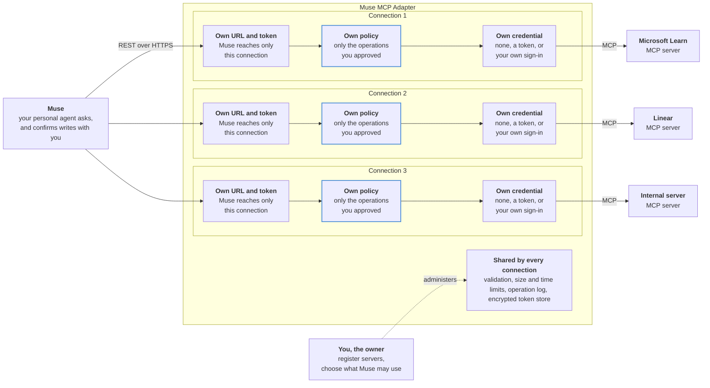
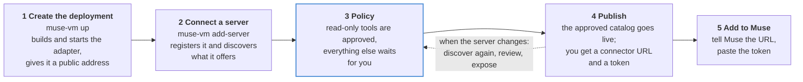
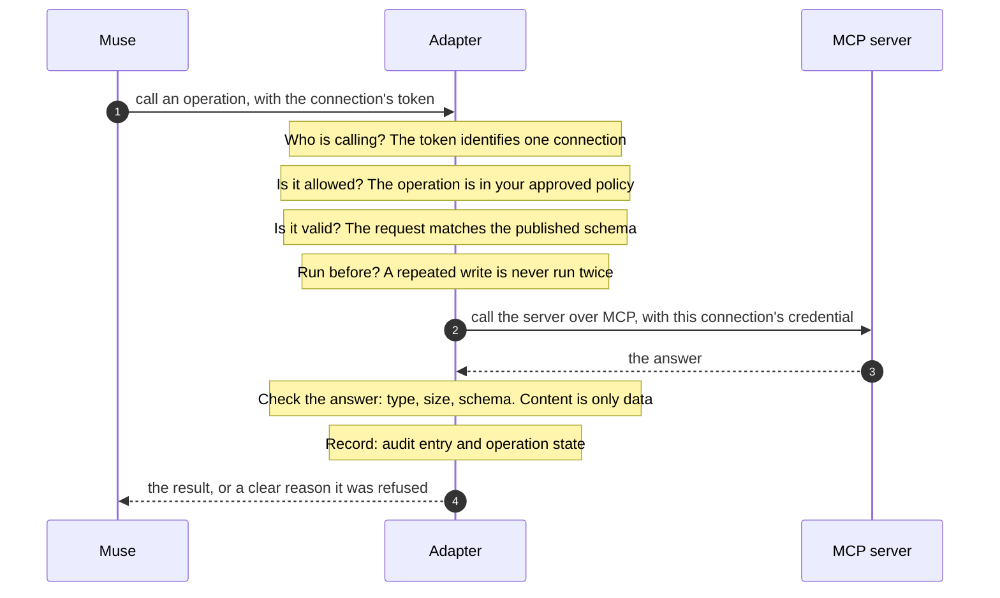
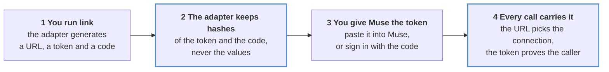
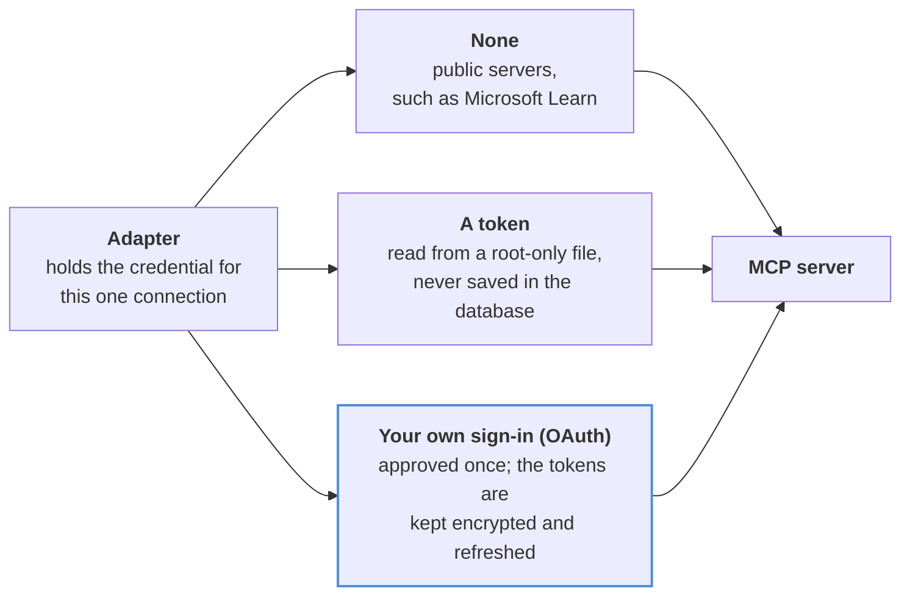

# Muse MCP Adapter

**Let Muse use any MCP server, safely.** The adapter sits between Muse and the MCP servers you rely on. It shows Muse only what you approve, keeps your credentials to itself, and makes sure a write runs once or says it may not have.



## Contents

**Understand it**
[What is it?](#what-is-it) · [What can you use it for?](#what-can-you-use-it-for) · [Why use it?](#why-use-it) · [How it works](#how-it-works) · [Key concepts](#key-concepts)

**Get started**
[Quick start](#quick-start) · [Step-by-step setup](#step-by-step-setup) · [Troubleshooting](#troubleshooting)

**Use it**
[Day to day](#day-to-day) · [Stay in control: your policy](#stay-in-control-your-policy) · [What Muse sees](#what-muse-sees)

**Reference**
[OpenAPI description](#how-the-adapter-exposes-an-openapi-description) · [Authentication](#how-authentication-works) · [Run it by hand](#run-it-by-hand-development) · [Provider packs](#reference-provider-packs) · [Scope](#scope) · [Documentation](#documentation) · [Development](#development)

## What is it?

[MCP](https://modelcontextprotocol.io) (Model Context Protocol) is how applications such as issue trackers, wikis, documentation sites, and databases publish tools, data, and prompt templates. Muse is a personal AI agent that adds services through Custom Connectors, which it reads from an OpenAPI description. Muse does not speak MCP, so MCP servers are out of its reach.

The adapter bridges the two:

- **Toward Muse** it is an ordinary REST API with an OpenAPI description. Muse adds it in chat like any custom connector.
- **Toward the MCP server** it is a careful MCP client, so the server sees a normal MCP conversation.
- **In between** it applies your rules: what is exposed, what counts as a read or a write, and the limits on each call.

For Muse it behaves almost like a transparent wrapper: using a server through the adapter is as good as talking to the MCP server directly, and the few differences are deliberate and visible.

## What can you use it for?

- **Look things up from Muse.** Connect a documentation or knowledge server, such as Microsoft Learn, and Muse can search official documentation and read whole pages while you chat. Ask "How do I raise the function timeout for Azure Functions on the Consumption plan?" and Muse searches, then answers from the real documentation.
- **Work with your tools through chat.** Connect an issue tracker, a wiki, or a database server, such as Linear or Atlassian, so Muse can read records and, with your confirmation, change them. Every write is marked, confirmed with you first, and runs once.
- **Share only part of a server.** A server may offer dozens of tools. Publish just the read-only ones, or just the three you need, and the rest do not exist for Muse.
- **Bring your own MCP servers to Muse.** Any MCP server, including one you wrote, becomes a Muse connector. You do not hand-write an API description or build a separate connector for each tool.
- **Keep credentials out of Muse.** Muse holds one revocable token per connector. The keys and sign-ins for the MCP servers stay inside the adapter.
- **Stay in control as servers change.** When a server adds, removes, or alters a tool, you see the difference and decide whether Muse gets it.
- **See what Muse did.** Every call is recorded with its operation, outcome, and duration, and a write's state is tracked until it is settled.

## Why use it?

MCP servers change on their own: tools appear, schemas shift, and a tool marked "read-only" may not be. Connecting Muse to that directly would mean handing Muse your credentials and letting upstream changes alter what it can do without anyone noticing.

- **You decide what Muse can reach.** Nothing is exposed until you review it and publish it. New or changed upstream tools never go live on their own.
- **Permissions are yours, not the server's.** You classify each operation as read, write, or sensitive write. What the server claims about itself is only a hint.
- **Writes are guarded.** Muse confirms with you before a write. The adapter runs it once, and if the outcome is unclear it never retries blindly.
- **Credentials stay with the adapter.** Muse gets one token per connection. The credentials for the MCP server never reach Muse.
- **Changes are caught.** The adapter compares each live server with what you published and reports anything added, removed, or changed.

The trade-off is one more service to run. For a single simple, stable MCP server you may not need it. It pays off when you want several servers behind one reviewed, consistent boundary.

## How it works



1. **You run the adapter on a small Linux machine you control.** One command, `muse-vm up`, builds it from this repository and starts it. The machine gets a public HTTPS address through Tailscale Funnel, and nothing on it accepts inbound connections.
2. **You connect an MCP server.** `muse-vm add-server` registers the server, looks at what it offers, and drafts a policy that exposes only its read-only tools. You decide whether to expose more.
3. **You add the connector to Muse.** You give Muse a connector address and a token. Muse reads the API description and can now use the tools you approved.
4. **Every call is checked.** When Muse calls a tool, the adapter confirms who is calling, that the operation is on your list, and that the input is valid. It then calls the MCP server with its own credential, checks the answer, records the call, and replies.



You run the adapter in your own environment, on your own machine and with your own accounts. There is no shared service in the middle, and no one else holds your credentials.

## Key concepts

| Term | What it means |
| --- | --- |
| **Server** | An MCP server you register by its address, such as Microsoft Learn or Linear. |
| **Policy** | Your list of what Muse may use. Anything not on it does not exist for Muse. |
| **Catalog** | The approved, versioned result of your policy. This is what Muse sees, and you can roll back to an earlier version. |
| **Connection** | One link between Muse and **one** MCP server: its own connector URL, token, policy, and credential. Add a second server and you get a second connection. It is a record inside the adapter, not a separate program, so one adapter process holds as many connections as you create. |
| **Connector URL** | The address you give Muse for a connection. Its random part only keeps the address private and routes the request to the right connection. It is not the security: every call still needs the connection's token. |

## Quick start

About five minutes of typing and fifteen of waiting. You need Python 3.12+, `git`, `ssh`, a Tailscale account that has [the one-time settings](#step-2--prepare-tailscale-once) switched on, and either a Google Cloud project or a Linux machine you can SSH into.

```bash
git clone https://github.com/sept-usc/muse-mcp-adapter && cd muse-mcp-adapter
python3 -m venv .venv && .venv/bin/python -m pip install .

# 1. Create the deployment (Google Cloud shown; for your own machine use --ssh user@host)
.venv/bin/muse-vm up --cloud gcp --project my-project

# 2. Connect an MCP server; it prints a connector address and a token
.venv/bin/muse-vm add-server learn --endpoint https://learn.microsoft.com/api/mcp
```

Then tell Muse: *"Create a connector called Microsoft Learn from the API spec at `<the connector address>`"*, click **Connect**, and paste the token. Ask Muse something that needs the documentation, and it will use the connector.

Every step is explained below, including what to expect and what to do if it does not work.

## Step-by-step setup

Setup is seven steps. Each one says what you do, what happens behind the scenes, how you know it worked, and where to look if it did not.

```text
 1 Check what you need ─▶ 2 Prepare Tailscale ─▶ 3 Get the code ─▶ 4 Create the deployment
                                                                              │
 7 Connect Muse and try it ◀─ 6 Decide what Muse can use ◀─ 5 Connect a server ◀┘
```

### Step 1 · Check what you need

| You need | For | Notes |
|---|---|---|
| A computer with **Python 3.12+**, **git** and **ssh** | Running `muse-vm` | This is *your* computer, not the adapter's. Docker is not needed on it |
| A **Linux machine** for the adapter | Hosting it | Either one you already have (Debian or Ubuntu, x86_64 or arm64, key-based SSH, passwordless `sudo`, 1 vCPU, 2 GB memory, 20 GB disk), or let `muse-vm` create one on Google Cloud |
| For Google Cloud: the **`gcloud` CLI**, signed in, and a project with billing | Creating the VM | Your account needs to create instances and firewall rules and to use Identity-Aware Proxy |
| A **Tailscale account** (the free plan is enough) | The public HTTPS address | Set up once in step 2 |
| Outbound internet access from the machine | Building the images | Docker Hub (base images) and PyPI (Python packages, checked against hashes) |
| The MCP server's **public HTTPS address** | Connecting a server | Private or plain-HTTP servers are refused |

**Why Tailscale?** Muse runs in the cloud and needs a public HTTPS address with a proper hostname (Muse refuses addresses that merely encode an IP, such as `203-0-113-7.sslip.io`). Tailscale Funnel provides one, with a certificate, without you opening a single port, owning a domain, or giving the machine a public IP.

### Step 2 · Prepare Tailscale (once)

**What you do.** Three one-time settings in your Tailscale account:

1. Open the [DNS settings](https://login.tailscale.com/admin/dns) and enable **HTTPS Certificates**.
2. Open the [access controls](https://login.tailscale.com/admin/acls/file), add the section below (or add the entry to an existing `nodeAttrs` section), and save:

   ```json
   "nodeAttrs": [
     { "target": ["autogroup:member"], "attr": ["funnel"] }
   ],
   ```

3. *Optional, and recommended:* under **Settings, Keys**, generate an **auth key** that is *single use*, *untagged* and expires in a day. Save it in a file only you can read, for example `~/my-tailscale-key`.

**What this does.** The first two settings allow your tailnet to publish a device on the public internet (Funnel). The auth key lets the machine join your tailnet without anyone clicking a sign-in link. Without a key, `muse-vm up` prints a link for you to open instead; the links expire after a few minutes, which is why a key is easier.

**You will know it worked when** `muse-vm up` in step 4 reaches "public address". If a setting is missing, `muse-vm up` says which one and prints the exact steps rather than waiting in silence.

### Step 3 · Get the code

```bash
git clone https://github.com/sept-usc/muse-mcp-adapter
cd muse-mcp-adapter
git checkout <the tag or commit you have reviewed>
python3 -m venv .venv && .venv/bin/python -m pip install .
```

**What this does.** It installs the `muse-vm` command. The adapter itself is not installed on your computer. It is built later, on the machine, from this same checkout.

**Why a checkout, not a download?** You run exactly the code you reviewed, and `muse-vm` records the commit in the image. It refuses to deploy a checkout with uncommitted changes (`--allow-dirty` overrides), so every deployment matches a commit you can name again.

### Step 4 · Create the deployment

Pick where the adapter runs. Each takes 10 to 20 minutes, most of it building the images. Pass the Tailscale key from step 2 as `TS_AUTHKEY`, or omit it to get a sign-in link.

**A. A Google Cloud VM that `muse-vm` creates**

```bash
TS_AUTHKEY="$(cat ~/my-tailscale-key)" .venv/bin/muse-vm up --cloud gcp --project my-project
```

It creates a network of its own (your project's default network is not used), a shielded VM with no service account and no public IP address (outbound traffic goes through Cloud NAT), allows SSH only from Google's Identity-Aware Proxy range, and schedules daily disk snapshots kept for 7 days. Options: `--zone`, `--machine-type` (default `e2-small`, about $13 a month plus about $2 for NAT and disk), `--budget-usd` (a budget alert), `--idle-stop-hours` (power off after inactivity).

**B. A machine you already have, over SSH**

```bash
TS_AUTHKEY="$(cat ~/my-tailscale-key)" .venv/bin/muse-vm up --ssh deploy@203.0.113.7
```

Use this for a VM from any provider or an on-premises server. It needs key-based SSH and passwordless `sudo`. For a non-standard key or port, add `--ssh-opt=-i/path/to/key` or `--ssh-opt=-p2222`. The machine needs no inbound port. It is changed as little as possible: the adapter lives in `/opt/muse-adapter`, Docker and automatic security updates are installed *only if missing* (an existing Docker is never restarted), and `muse-vm down` removes exactly what was added.

**C. A virtual machine on your own computer, to try it first**

Create any Ubuntu or Debian VM (OrbStack, Multipass, UTM), make sure you can SSH in with a key and `sudo` without a password, and follow **B**.

**What `up` does.** It prints a numbered progress line for each stage and stops with a clear message if one fails. If a stage fails, it removes what it created (add `--keep-on-failure` to keep it for inspection).

| Stage | What happens |
|---|---|
| 1 Preflight | Checks your tools and credentials and the machine, and that nothing is installed there already |
| 2 Provision | Google Cloud only: creates the network, firewall rule, NAT, VM and snapshot schedule |
| 3 Install | Prepares Docker, security updates and log limits (only what is missing), uploads the source, and builds the two images: the adapter and the egress guard |
| 4 Start | Starts the containers and Tailscale; waits for the device to join and for Funnel to be published; fetches the HTTPS certificate ahead of time |
| 5 Public address | Learns the address, for example `https://muse-adapter-prod.tail1234.ts.net` |
| 6 Self-check | Tests it from outside (HTTPS answers with the security headers; requests without or with a wrong token are refused) and from inside (the guard blocks the cloud metadata server and private networks; the adapter runs as a non-root user with a read-only filesystem; its data directories are private) |

**You will know it worked when** it ends with `The adapter is running at https://…` and eleven green checks. `muse-vm status` shows the deployment and `muse-vm selfcheck` repeats the checks whenever you like. If something fails, go to [Troubleshooting](#troubleshooting).

### Step 5 · Connect an MCP server

```bash
# A public server that needs no sign-in
.venv/bin/muse-vm add-server learn --endpoint https://learn.microsoft.com/api/mcp

# A server that takes a token: store the token first (typed at a hidden prompt, never on a command line)
.venv/bin/muse-vm secret set GITHUB_TOKEN
.venv/bin/muse-vm add-server github --endpoint https://api.githubcopilot.com/mcp/ \
    --credential env_token --secret-name GITHUB_TOKEN

# A server that signs you in with OAuth: it prints a link to open and approve
.venv/bin/muse-vm add-server linear --endpoint https://mcp.linear.app/mcp --credential oauth
```

**What this does.** `add-server` registers the server by its address, connects to it and discovers its tools, drafts a policy that exposes **only the read-only tools**, publishes that as version 1.0.0, and creates a connection for Muse. If you run several deployments, add `--name <deployment>`.

**The token for the MCP server** is stored in a root-only folder on the machine and never leaves it. Muse never sees it.

**You will know it worked when** it prints the list of exposed tools, then a **connector address**, a **token** and a **connection code**. These are shown once, and the adapter keeps only hashes of the token and code. The command also prints the sentence to send to Muse and copies it to your clipboard; that sentence holds no secret.

### Step 6 · Decide what Muse can use

Writes are never exposed by default. To let Muse use specific write tools, publish a new version:

```bash
.venv/bin/muse-vm expose github --allow issue_write --allow add_issue_comment --allow create_pull_request
```

**What this does.** It publishes a new catalog version that adds exactly those tools. Everything already published keeps its settings. Muse sees the change on its next request, and the connector address and token do not change. Use `--deny TOOL` to withdraw a tool.

**What protects you.** Muse asks you before it calls a write. The adapter runs each write once, and if it cannot tell whether a write happened it marks it `UNKNOWN` and never retries it blindly. See [Stay in control](#stay-in-control-your-policy).

### Step 7 · Connect Muse and try it

1. Open a **new side chat** in Muse (not your main chat) and send: `Create a connector called GitHub from the API spec at <the connector address>`.
2. Muse reads the API description and shows a **Connect** card. Click **Connect** and accept Muse's consent dialog.
3. Paste the **token** when Muse asks. (Or, if Muse offers it, sign in with the **connection code**.)
4. Muse says the connector is connected. Try it:
   - *"List the open pull requests in my repository `<owner>/<repo>`."* (a read)
   - *"Create an issue titled 'test' in that repository."* (a write; Muse confirms first)

**You will know it worked when** Muse answers with real data, and `muse-vm logs` shows the matching `POST …/operations/<name> 200` lines.

You are done. For what to do next (more servers, updates, backups), see [Day to day](#day-to-day).

## Troubleshooting

Start with the two commands that explain most problems:

```bash
.venv/bin/muse-vm selfcheck     # each line says what passed or failed
.venv/bin/muse-vm logs          # the adapter's log; also: logs tailscale, logs guard
```

Add `-v` to any `muse-vm` command to print every command it runs. If `up` fails it removes what it created; add `--keep-on-failure` to keep the machine for inspection.

### While creating the deployment (`muse-vm up`)

| What you see | Why | What to do |
|---|---|---|
| `your tailnet does not allow HTTPS and Funnel yet` | The one-time Tailscale settings are missing | Do what it prints: enable HTTPS certificates, and add the `nodeAttrs` Funnel entry to the access controls ([step 2](#step-2--prepare-tailscale-once)). It keeps waiting, so you can fix it while it runs |
| It prints a Tailscale sign-in link and then times out | The link expired before it was opened (they last a few minutes) | Use an auth key (`TS_AUTHKEY`), or open the newest link as soon as it appears |
| `this tailnet requires device approval` | Your tailnet approves new devices | Approve the device under **Machines** in the Tailscale console |
| `That does not look like a Tailscale auth key` | The key was pasted with extra text, or is not a `tskey-` key | Generate a new one and save it without spaces or prefixes |
| The address does not resolve, or `up` waits a long time at the self-check | A brand-new Funnel name can take up to ten minutes to reach public DNS | Wait. `muse-vm selfcheck` checks again, and uses public DNS so a computer that is itself in your tailnet is not misled |
| The address ends in `-1` or `-2` | An older device with the same name is still in your tailnet | Harmless. Delete the stale offline device under **Machines**. `muse-vm down` signs devices out, so this happens only after an interrupted run |
| `Cannot run commands on … with sudo -n` | SSH key login or passwordless `sudo` is missing on the machine | Fix the login (`ssh user@host sudo -n true` must work), then run `up` again |
| Google Cloud: it waits for SSH for several minutes | A new VM is still booting and installing Docker, or IAP access is not granted | Give it up to 10 minutes. It retries dropped connections itself. If it never connects, check that your account has the IAP tunnel and OS Login roles |
| `A network named mma-… already exists` | A previous run left something behind | `muse-vm down --name <name>`, or choose another `--name` |
| The image build fails or hangs | The machine cannot reach Docker Hub or PyPI | Allow outbound HTTPS from the machine, or build the images elsewhere and use `--image` and `--guard-image` ([reference](docs/deployment.md#how-the-images-are-built)) |
| `The checkout … has uncommitted changes` | You edited files that are deployed | Commit or stash them, so the deployment matches a commit |
| The self-check fails on `/health` but the checks inside the machine pass | The public address is not reachable from here yet, or Tailscale is disconnected | `muse-vm logs tailscale`; check the device is online in the Tailscale console |

### While connecting a server (`muse-vm add-server`)

| What you see | Why | What to do |
|---|---|---|
| `The server offers no such tool` | A tool name in `--allow` or `--deny` is misspelled | The message lists the tools the server offers |
| It refuses a private or `http://` address | By design: the adapter only calls public HTTPS servers | Use the server's public HTTPS address. A server on a private network needs `--egress-allow` and a deliberate policy decision |
| The server returns an authentication error | The token is wrong, expired, or lacks permission | `muse-vm secret set NAME` again with a correct token. For GitHub, check the token's repository access and permissions |
| An OAuth server shows "reconnect" | The sign-in expired | Open the link it prints and approve again |

### While connecting or using Muse

| What you see | Why | What to do |
|---|---|---|
| Muse says it cannot create the connector from that address | Muse accepts only ordinary public hostnames, not ones that encode an IP (`…sslip.io`) | Use the `*.ts.net` address `muse-vm up` printed |
| Muse says 401 or "token invalid" | The token was rotated, belongs to a different connector, or has a typo | `muse-vm rotate-token SERVER` and paste the new token |
| Muse says the server is unavailable | The machine is stopped, or Tailscale is disconnected | `muse-vm status`; `muse-vm start` |
| Muse cannot use a tool you expected | It is not published, or is a write | `muse-vm expose SERVER --allow TOOL` |
| A write shows `UNKNOWN` | The call may or may not have happened | Check the other system, then settle it with the adapter's `reconcile` command ([usage guide](docs/usage.md#1-command-line-tool)). It is never retried automatically |
| Muse reports success but nothing changed | An identical write within 30 seconds of an earlier one is treated as a retry and replays the first result | The response says `idempotentReplay`. Ask again after a moment, or send an `Idempotency-Key` |

### While it runs

| What you see | Why | What to do |
|---|---|---|
| The adapter stopped | The machine rebooted, or a container crashed | Both recover by themselves, usually within a minute. `muse-vm status` shows the state |
| The disk is filling up | Logs and backups | Container logs rotate at 50 MB; delete old backups you no longer need |
| You lost the backup passphrase | Backups are encrypted with it and cannot be recovered | Make a new backup with a new passphrase while the machine is healthy |
| After a restore, a server stops working | Server tokens are not part of a backup | `muse-vm secret set NAME` again |

### Still stuck?

Collect `muse-vm status`, `muse-vm selfcheck` and `muse-vm logs` (they contain no secrets), then see [Running on a VM](docs/operations.md) for more, or open an issue with that output.

## Day to day

| Task | Command |
|---|---|
| Health, containers, connected servers | `muse-vm status`, `muse-vm selfcheck`, `muse-vm servers` |
| Add another MCP server | `muse-vm add-server …` (step 5); it gets its own connector and token |
| Change what Muse can use | `muse-vm expose SERVER --allow TOOL` / `--deny TOOL` |
| Logs | `muse-vm logs` (adapter), `muse-vm logs tailscale` |
| New version | `git pull`, review what changed, then `muse-vm upgrade` (address, connections and data stay) |
| Backup and restore | `muse-vm backup --out FILE` (encrypted with a passphrase you choose), `muse-vm restore FILE` |
| A leaked token | `muse-vm rotate-token SERVER` |
| Pause to save money | `muse-vm stop`, `muse-vm start` (on Google Cloud this powers the VM off) |
| Remove everything | `muse-vm down` (signs the device out of Tailscale and deletes what was created) |

Reference for everything above: [deployment reference](docs/deployment.md) (what is installed, every command), [running on a VM](docs/operations.md), [identity and authentication](docs/authentication.md) (every credential and how it is protected) and [network exposure](docs/networking.md) (what is reachable from where).

## Stay in control: your policy

`policy-template` drafts a policy from what the server offers. It starts closed: `--expose-reads` pre-approves everything read-only (tools the server marks read-only, plus its resources and prompts), and writes always start switched off. You edit the file, and only entries with `"allowed": true` are exposed.

| You decide | Field | Default |
| --- | --- | --- |
| Is it exposed to Muse? | `allowed` | No |
| Read, write, or sensitive write? | `classification` | Write, unless the server marks the tool read-only and you accept that |
| What Muse is told about it | `description` | The server's text, pinned at publish so the server cannot change it later |
| The name Muse sees | `publicOperationId` | Derived from the tool's name |
| How long and how large | `timeoutSeconds`, `maxResultBytes` | 30 seconds, 256 KB |
| Which resources and arguments | `resource` block (`allowedUriSchemes`, `argumentPatterns`, ...) | Strict |

A single entry, taken from a real Microsoft Learn policy:

```json
{
  "primitiveKey": "tool:microsoft_docs_search",
  "allowed": true,
  "publicOperationId": "microsoft_docs_search",
  "classification": "read",
  "description": "Search official Microsoft/Azure documentation ...",
  "timeoutSeconds": 30,
  "maxResultBytes": 262144
}
```

The adapter enforces this on every request:


If the server changes later, run `discover-remote` again and then `drift` to see what was added, removed, or altered. Muse keeps seeing the published catalog until you review the change and publish a new version, and `rollback` returns to the previous one. See the [policy reference](docs/usage.md#2-policy-file) for every field.

## What Muse sees

Every connection exposes the same small, fixed API under its own URL:

| Request | Purpose |
| --- | --- |
| `GET /c/<slug>/openapi.json` | The API description Muse reads when you add the connector. It lists only the operations you approved. |
| `POST /c/<slug>/operations/<name>` | Calls one approved tool, resource, or prompt. |
| `GET /c/<slug>/executions/<id>` | Looks at one earlier call: its status, progress, and log messages. |
| `POST /c/<slug>/executions/<id>/resume` | Answers a question the server asked in the middle of a call. |

The routes never change. What the server offers is reflected in the generated description, which lists the operation names and their inputs. Every request carries the connection's token, and a request without a valid one is refused.

### Responses

| Status | Meaning |
| --- | --- |
| `200` | The operation completed. |
| `400` | The request did not match the operation's input schema. |
| `401` | The token is missing, invalid, or revoked, or the linked account must sign in again (the error then includes a fresh sign-in link). |
| `403` | The connection may not use this operation, or the connector is disabled. |
| `404` | The operation or execution does not exist, or is not in the published catalog. |
| `409` | The operation needs an answer, is still running, or its outcome is unknown and must not be retried blindly. |
| `413` | The request body is too large. |
| `429` | Too many requests. |
| `502` | The MCP server failed, timed out, or returned something outside your limits. The message says which. |

### How MCP behaviour shows up through the API

| In MCP | Through the adapter |
| --- | --- |
| A tool that changes data | The operation is marked `x-requires-confirmation`, so Muse confirms with you before calling it. |
| A repeated write | An `Idempotency-Key` (Muse's, or one derived from the request) makes a repeat return the stored result, flagged `idempotentReplay`, instead of running again. |
| A write whose outcome is unclear | `409` with `UNKNOWN_OUTCOME`. It is not retried until you check the system and run `reconcile`. |
| The server asks a question mid-call | `409` with `INPUT_REQUIRED`, the question, and how to answer it. Muse asks you, then calls `.../resume` with your answer. |
| Progress and log messages | Returned with the result. |
| Images, audio, linked and embedded content | Returned as typed content blocks. |
| A result over your size limit, or a call over your time limit | `502` with a message that names the limit, so it is not mistaken for an outage. |
| A tool error | `502` with the server's message. |

---

*Everything below is reference material for when you need the detail.*

## How the adapter exposes an OpenAPI description

Muse learns what it can call from an OpenAPI description, so the adapter produces one for every connection. You never write it. It is generated from what the MCP server offers, filtered by your policy.

```text
discover        the adapter asks the MCP server what it offers and stores the answer
policy          you choose what is exposed
publish         the approved subset becomes the live, versioned catalog
Muse asks       the adapter compiles the OpenAPI description from that catalog, right then
```

The description is served at the connector URL (`/c/<slug>/openapi.json`). It is built from the approved catalog on every request, so it only ever lists approved operations, and it changes only when you publish a new version. It contains no secrets and no MCP endpoint.

### How MCP maps to OpenAPI

Every approved tool, resource, resource template, or prompt becomes one operation: `POST /c/<slug>/operations/<name>`.

| MCP | Becomes | Request body |
| --- | --- | --- |
| **Tool** | An operation | The tool's own input schema |
| **Resource** | A read operation that names the resource | None |
| **Resource template** such as `issues://{project}/{id}` | A read operation | One required field per template variable |
| **Prompt** | A read operation that returns the prompt's messages | One field per prompt argument |

### What each operation contains

| In the description | Where it comes from |
| --- | --- |
| `operationId` and path | The name you chose in your policy (derived from the tool's name by default) |
| `description` | The text pinned in your policy, plus a note on whether it reads or changes data |
| Request body schema | The MCP tool's input schema, translated to OpenAPI 3.1 |
| `x-muse-classification` | Your classification: `read`, `write`, or `sensitive_write` |
| `x-requires-confirmation` and an `Idempotency-Key` header | Added to every write, so Muse confirms with you first and a retry never runs twice |
| `responses` | A fixed set, listed below |
| `security` | Both ways to authenticate, described under authentication |

A real excerpt, generated from Microsoft Learn's `microsoft_code_sample_search` tool:

```json
{
  "/operations/microsoft_code_sample_search": {
    "post": {
      "operationId": "microsoft_code_sample_search",
      "summary": "Microsoft Code Sample Search",
      "description": "Search for code snippets in official Microsoft Learn documentation. ... Read-only: retrieves information and does not change anything.",
      "x-muse-classification": "read",
      "requestBody": {
        "content": {"application/json": {"schema": {
          "type": "object",
          "properties": {
            "query": {"type": "string", "description": "a descriptive query, SDK name, method name ..."},
            "language": {"type": ["string", "null"], "description": "Optional programming language filter ..."}
          },
          "required": ["query"]
        }}}
      },
      "responses": {"200": {"...": "..."}, "400": {"...": "..."}, "401": {"...": "..."}, "409": {"...": "..."}, "502": {"...": "..."}}
    }
  }
}
```

Every operation answers with the same result shape: the content the server returned (text, images, audio, links, or structured data), the operation's status, and any progress and log messages the server sent while working.

## How authentication works

There are two separate sign-ins, and they never mix. Muse never sees the credential for the MCP server, and the server never sees Muse's token.

**Muse to the adapter**: proves Muse may use this connection.



**Adapter to the MCP server**: proves who you are to the server. Neither side's credential is ever sent to the other.



### Muse to the adapter

1. You run `link`. The adapter **generates** a connector URL, a token, and a connection code, prints them once, and keeps only a hash of the token and of the code.
2. You give Muse the token, in one of two ways. **Paste the token** into the secure field Muse shows when it adds the connector, or **sign in**: Muse opens a page, you enter the connection code, and Muse receives short-lived tokens that it refreshes itself. The adapter offers both in its API description, and Muse picks one.
3. From then on every request carries `Authorization: Bearer <token>`. The adapter uses the connector URL to find the connection, hashes the token, and compares it with that connection's stored hash. A token for one connection is refused by every other, and a request without a valid token is refused with a 401.

The random part of the connector URL only selects the connection and keeps its API description unlisted. The token is what authenticates. If a token or code leaks, `rotate-token` ends every session for that connection, and `unlink` removes the connection.

**How Muse learns which authentication to use.** The API description declares both options in its `security` section, and Muse picks one:

```json
"security": [{"oauth2": ["connector"]}, {"bearerAuth": []}]
```

- `bearerAuth` is a plain bearer token. Muse asks you for the value.
- `oauth2` is an authorization-code flow with PKCE, served by the adapter itself. The description lists its authorize, token, and refresh addresses. The adapter acts as the authorization server for Muse: it registers Muse as a client, asks for the connection code on a consent page, then issues access tokens (valid for an hour) and refresh tokens that rotate on every use.

A request without a token also gets a `401` with a `WWW-Authenticate` header that points to the adapter's standard OAuth discovery document, so a client that does not read the description can still find out how to sign in.

### The adapter to the MCP server

You choose this per connection when you run `link --credential ...`:

| `--credential` | Use it when | How it works |
| --- | --- | --- |
| `none` | The server is public, such as Microsoft Learn. | Nothing is sent. |
| `env_token` | The server takes an API key or token. | The adapter reads it when it needs it, from the environment variable you name with `--token-env` or, on a VM, from a file in the root-only secrets folder (`muse-vm secret set`). It is never written to the database. |
| `oauth` | The server signs users in with OAuth, as Linear and Atlassian do. | `link` prints a one-time sign-in link. You open it and approve the adapter at the server's own sign-in page. The server sends your browser back to the adapter, which exchanges the result for tokens, stores them encrypted, and refreshes them itself. Muse is not part of that redirect and never sees the tokens. If they ever stop working, the adapter tells Muse to reconnect and includes a fresh sign-in link. |

## Run it by hand (development)


You do steps 1 to 5 once per server. Step 6 happens in Muse's chat.

Requires Python 3.12+.

```bash
python3 -m venv .venv
.venv/bin/python -m pip install -e .
```

Muse needs to reach the adapter over HTTPS. For a trial on your own machine, a tunnel such as `ngrok http 8080` gives you a public address. Put it in `serve.json`:

```json
{"publicUrl": "https://<your-public-address>"}
```

### Try it with a public server

Microsoft Learn's MCP server needs no sign-in and only reads documentation, so it is a safe first server.

```bash
adapter=".venv/bin/muse-mcp-adapter --database adapter.db --config serve.json"

$adapter server-register --server-id learn --display-name "Microsoft Learn" \
  --endpoint https://learn.microsoft.com/api/mcp --auth-profile none
$adapter discover-remote --server-id learn
$adapter policy-template --server-id learn --expose-reads > policies.json
$adapter publish  --server-id learn --catalog-version 1.0.0 --policies policies.json
$adapter activate --server-id learn --catalog-version 1.0.0
$adapter link --server-id learn --label "Microsoft Learn" --credential none
$adapter serve
```

`link` prints the connector URL, a token, a connection code, and the sentence to tell Muse. The token and code are shown once.

In Muse, ask it to create a connector from that URL, then paste the token when it asks (or sign in with the connection code). Muse reads the public API description, and from then on can use the server's tools.

### A server that needs a token

```bash
export PROJECT_SYSTEM_TOKEN=...   # the server's API key, kept in your environment

$adapter server-register --server-id project-system --display-name "Project System" \
  --endpoint https://mcp.example.com/mcp --auth-profile bearer_token
$adapter discover-remote --server-id project-system --token-env PROJECT_SYSTEM_TOKEN
$adapter policy-template --server-id project-system --expose-reads > policies.json
$adapter publish  --server-id project-system --catalog-version 1.0.0 --policies policies.json
$adapter activate --server-id project-system --catalog-version 1.0.0
$adapter link --server-id project-system --label "Project System" \
  --credential env_token --token-env PROJECT_SYSTEM_TOKEN
```

### A server that signs you in with OAuth

Create the connection first, sign in through the link it prints, then discover with that connection's credential:

```bash
$adapter server-register --server-id linear --display-name Linear \
  --endpoint https://mcp.linear.app/mcp --auth-profile oauth
$adapter link --server-id linear --label Linear --credential oauth     # prints a sign-in link
# open the link in your browser and approve access at the server's page
$adapter discover-remote --server-id linear --connection-id <id printed by link>
$adapter policy-template --server-id linear --expose-reads > policies.json
$adapter publish  --server-id linear --catalog-version 1.0.0 --policies policies.json
$adapter activate --server-id linear --catalog-version 1.0.0
```

The sign-in link and the provider's redirect both go through the adapter's public address, so `publicUrl` must be reachable from your browser. If a provider does not support dynamic client registration, add its client id under `oauthClients` in `serve.json` (see the [usage guide](docs/usage.md#3-running-the-service)).

Want to try it without Muse or a real provider? The [usage guide](docs/usage.md#try-it-locally) walks through a sample MCP server and a script that behaves like Muse.

## Reference provider packs

Provider packs hold endpoint and safety settings for common servers. They add no provider-specific code and never authorize discovered tools automatically.

| Pack | Endpoint | Safe starting point |
| --- | --- | --- |
| [Linear](https://linear.app/docs/mcp) | `https://mcp.linear.app/mcp` | Start from the documented read-only endpoint; classify and approve writes explicitly |
| [Atlassian](https://atlassian.github.io/atlassian-mcp-server/) | `https://mcp.atlassian.com/v2/mcp` | Use least-privilege scopes; classify and approve writes explicitly |
| [Supabase](https://supabase.com/docs/guides/ai-tools/mcp) | `https://mcp.supabase.com/mcp` | Require `project_ref`; `read_only=true` by default |

These are starting points, not a claim that everything a provider offers is safe to publish. Run discovery, review it, and write your own policy for the account you control.

## Scope

**Supported:** remote MCP servers over Streamable HTTP; tools, resources, resource templates, and prompts; progress and log messages, questions asked mid-call, and image, audio, and linked content; authentication to MCP servers with no credential, a static token, or OAuth.

**Not included:** local `stdio` servers, MCP Apps rendering, a hosted marketplace, or billing. Each deployment serves one owner.

## Documentation

- [Contributing](CONTRIBUTING.md) and [security policy](SECURITY.md)
- [Usage guide](docs/usage.md): configuration, policy reference, API, and operations
- [Deploying on a VM](docs/deployment.md): one command to host the adapter on Google Cloud or any Linux machine
- [Running on a VM](docs/operations.md): prerequisites, how it runs, and troubleshooting
- [Identity and authentication](docs/authentication.md): every identity and credential, and how each is protected
- [Network exposure](docs/networking.md): what is public, what is private, and what the adapter may reach
- [Security model](docs/security.md): controls and guarantees
- [Validation guide](docs/validation.md): how parity with a direct MCP connection is tested, and the [Atlas validation server](docs/validation-server.md)
- [System design](docs/design.md)
- [Control plane](docs/control-plane.md) and [data plane](docs/data-plane.md)

## Development

```bash
python3 -m venv .venv && .venv/bin/python -m pip install -e '.[dev]'
git config core.hooksPath .githooks     # run the full gate before every commit
```

See [CONTRIBUTING.md](CONTRIBUTING.md) for how to contribute. Nothing is committed unless the whole gate passes. `scripts/verify.sh` runs everything CI runs, locally and first: workflow syntax and a check that every GitHub Action version exists; lint, type-check and the full test suite on Linux with Python 3.12, and again in your own virtualenv; a build of both container images with a start-up check; a vulnerability scan of the images; a check that every link in the documentation resolves; and a render of every Mermaid diagram. It needs Docker running and `gh` signed in, and it fails rather than skipping a step when they are missing. Diagrams are written in Mermaid (a fenced `mermaid` block), not as images, so they render on GitHub, diff in a pull request and cannot go stale as a separate file. For quick feedback while you work, `scripts/verify.sh --quick` runs lint, types and tests on your machine only; it is not the commit gate.
