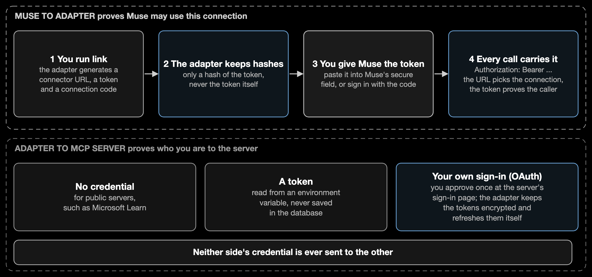

# Identity and authentication

This page lists every identity in a deployment, the credential each one uses, where that credential comes from, where it is kept, and what happens if it leaks. The adapter sits between three parties — **you (the owner)**, **Muse**, and **each MCP server** — and each pair uses a different credential. No credential is ever reused for another pair.

## Who is who

| Identity | What it is | How it is identified |
|---|---|---|
| **Owner** | You. One adapter serves one owner. | Operator access to the machine (see [Operator](#4-operator--the-machine)). There is no owner login on the HTTP service. |
| **Connection** | One link between Muse and one MCP server. The unit of access: tokens, rate limits, idempotency keys, operations and artifacts are all scoped to it. | A connection id, a random connector address (`/c/<slug>`), and a bearer token. |
| **Muse** | The caller. Muse has no identity of its own at the adapter; it is whoever holds a connection's token. | The connection's bearer token or an OAuth access token issued for that connection. |
| **MCP server credential** | What the adapter presents to a server on your behalf. | None, a static token, or your own OAuth sign-in at that server. |

## Credential inventory

| # | Credential | Used by → for | Where it comes from | Where it is kept | Lifetime | If it leaks |
|---|---|---|---|---|---|---|
| 1 | **Bearer token** `mcpa_…` (256-bit random) | Muse → adapter, every request | Generated by `link` / `add-server`; printed once | Muse (pasted into its secure field). The adapter keeps only a SHA-256 hash | Until rotated or unlinked | Attacker can call only that connection's *published* operations. `rotate-token` ends it and every session |
| 2 | **Connector address** `/c/<slug>` (128-bit random) | Muse → adapter, to pick the connection | Generated by `link` | Muse; the adapter's database | Until unlinked | Reveals the API description (tool names and schemas, no secrets). Cannot call anything without the token |
| 3 | **Connection code** (60-bit, shown once) | Owner → adapter consent page, to link Muse by sign-in | Generated by `link`, `link-code`, `rotate-token` | You; the adapter keeps a scrypt hash | 24 hours, single purpose | Five wrong tries lock sign-in for 15 minutes. Replace with `link-code` |
| 4 | **OAuth access token** `mcpa_at_…` | Muse → adapter, after sign-in | Issued by the adapter after the code is entered (authorization code + PKCE S256) | Muse; the adapter keeps a hash | 1 hour | Same reach as #1 but expires; revoked by `rotate-token` / `unlink` |
| 5 | **OAuth refresh token** `mcpa_rt_…` | Muse → adapter, to renew #4 | Issued with #4 | Muse; hash at the adapter | Rotates on every use; reuse of an old one ends the session | Reuse detection revokes the whole session |
| 6 | **Static server token** (for `env_token` servers) | Adapter → MCP server | You obtain it from the provider and store it with `muse-vm secret set NAME` | A file in the VM's root-only `secrets` directory, mounted read-only into the container | Until you rotate it at the provider | Attacker with VM access acts as you at that server; rotate at the provider |
| 7 | **Owner's OAuth tokens at a server** (for `oauth` servers) | Adapter → MCP server | You sign in at the provider's own page through a one-time link; the adapter exchanges the result itself (PKCE) | Encrypted in `adapter.oauth` with a key in `adapter.key`, both owner-only in `/data` | Provider-defined; the adapter refreshes them | Needs both files. Revoke the adapter's access in the provider's account settings |
| 8 | **Operator access** | You → VM | Google Cloud: your Google account via OS Login and Identity-Aware Proxy. Existing machine: your SSH key and passwordless `sudo` | Your computer / Google | Per your account policy | Full control of the adapter and its secrets |
| 9 | **Tailscale device credentials** | The adapter's machine → Tailscale | Either an interactive sign-in link you open once, or a single-use **auth key** you generate in the Tailscale console and pass as `TS_AUTHKEY` | The device's own state in `ts-state/` (root-only). An auth key is removed from the machine as soon as the device has joined | Until you remove the device | Whoever holds the state can act as that device in your tailnet. Delete the device in the Tailscale console. A leaked auth key is useless once used or expired |
| 10 | **Backup passphrase** | Owner → `.mmavm` backup files | Chosen by you at backup time (12 or more characters) | You only; never stored | — | Backups contain keys and tokens; whoever has the file and the passphrase has them |

## 1. Muse → adapter

1. You run `add-server` (or `link`). The adapter generates #1, #2 and #3, prints them once, and stores only hashes.
2. You give Muse the connector address. Muse learns from the API description that the adapter supports two methods and chooses one:
   - **Paste the token** (#1) into Muse's secure field. Muse sends `Authorization: Bearer <token>` on every call.
   - **Sign in.** Muse registers itself as an OAuth client, opens the adapter's consent page, you enter the connection code (#3), and Muse receives #4 and #5 and renews them itself.
3. For every request the adapter looks up the connection by the address, hashes the presented token, and compares it in constant time with that connection's stored hash. A valid token for a *different* connector gets the same answer as an invalid one, so connectors cannot be probed.
4. The token — never the request body — decides who the caller is. Requests cannot name a different connection, server, or owner.

**How secure:** tokens are 256-bit random values, so guessing is not feasible; they are stored only as hashes, so a stolen database or backup does not reveal usable tokens; each is limited to one connection; the sign-in flow uses PKCE, single-use one-minute codes, exact redirect matching, rotating refresh tokens with reuse detection, and a lockout on the connection code.

## 2. Adapter → MCP server

You choose per connection:

| Mode | What is sent | Notes |
|---|---|---|
| `none` | Nothing | For public servers (for example Microsoft Learn) |
| `env_token` | `Authorization: Bearer <server token>` | Token read from the secrets directory at call time; never written to the database, logs, or the audit trail |
| `oauth` | The owner's access token for that server | Obtained once by the owner at the provider's own page; encrypted at rest; refreshed by the adapter. Muse is not part of that redirect and never sees these tokens |

Every outbound connection must be HTTPS to a public address; redirects are not followed; and on a VM the egress guard additionally blocks the cloud metadata server and private ranges. A credential belongs to exactly one connection and cannot be shared.

## 3. Provider sign-in (OAuth servers only)

The one-time link `/connect/<nonce>` is single use and expires. Opening it sets a cookie that binds the flow to that browser; the provider's redirect to `/oauth/callback` is accepted only from that browser with the matching state. This prevents someone else from attaching their provider account to your connection. The link and the callback must be reachable from your browser, so they are served on the adapter's public address.

## 4. Operator → the machine

There is **no administrative HTTP interface**. All administration (registering servers, publishing policies, linking, rotating tokens) runs as commands inside the container, started over SSH.

| Target | How the operator authenticates | What is exposed |
|---|---|---|
| Google Cloud VM | Your Google account, authorized by IAM through OS Login; SSH travels through Identity-Aware Proxy | Port 22 is open only to Google's IAP range. Project-wide SSH keys are blocked; the serial console is off |
| Existing machine | Your SSH key; passwordless `sudo` | Whatever that machine already exposes |

The `--actor` name recorded in the audit trail is a label you supply, not a verified identity; the strong identity is whoever could reach the machine.

## 5. Data at rest

| Data | Protection |
|---|---|
| Tokens (#1, #3, #4, #5) | Hashed (SHA-256 for tokens, scrypt for the connection code) |
| Provider OAuth tokens (#7) | Encrypted with Fernet (authenticated encryption); the key is in an owner-only file beside the database |
| Server tokens (#6) | Files in a 0700 directory, mounted read-only into a non-root container |
| Database and artifacts | Owner-only permissions on a volume only the container user and root can read |
| Backups | The `.mmavm` file is encrypted with your passphrase (scrypt + AES-GCM). The raw `backup` folder on the VM is owner-only but not encrypted |
| Disk snapshots (Google Cloud) | Encrypted by Google at rest with Google-managed keys; they contain everything on the disk |

Anyone with root on the VM (including an OS Login administrator) can read the key file and the secrets. Treat operator access as the root of trust.

## Known limitations and accepted risks

| Item | Why it is acceptable, and what to do |
|---|---|
| No lockout on repeated bad bearer tokens | A token has 256 bits of entropy and the connector address 128, so guessing is infeasible. Per-connection rate limits still apply to valid callers. Use `rotate-token` if you see unexpected failures in the audit trail |
| The API description (`/c/<slug>/openapi.json`) is reachable without the token | It holds only tool names and input schemas, under an unguessable address. Unlinking or disabling the server removes it |
| `/health` answers without authentication | It returns only `{"status":"ok"}` |
| The connection code is shown in your terminal | Treat the terminal output like a password; it expires after 24 hours and can be replaced |
| `--actor` is self-asserted | Operator identity is enforced by access to the machine, not by this label |
| Tailscale auth key | If you supply `TS_AUTHKEY`, it sits in the root-only `.env` only until the device has joined, then it is removed. Use a single-use key that expires in a day. The default is an interactive sign-in link that stores nothing |
| Muse's own storage of the token | Outside the adapter's control. If you suspect it, run `rotate-token` |
| The machine is a device in your tailnet | Under a default Tailscale policy it can reach, and be reached by, your other devices. Tag it and restrict it in the access controls if that is not acceptable |
| Catalog integrity signing is off in the VM bundle | Catalogs are protected by file permissions and the database instead; enabling signing requires the same key to be present at restore |
