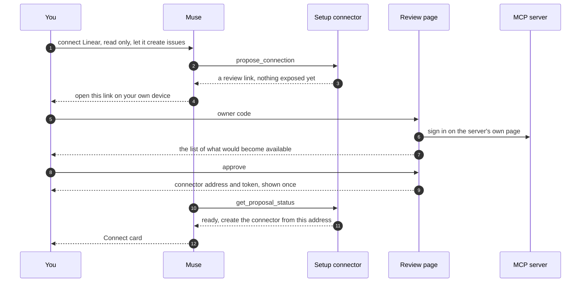

# Set up servers by chatting with Muse

Adding a server today means a terminal: register it, sign in, draft a policy, publish, then create the connector in Muse. Chat setup moves that into the conversation. You add **one** connector to Muse by hand, once. After that you tell Muse which servers to connect and what it may use, and the adapter turns that into the same published catalog it always enforces. The one thing Muse cannot do is approve its own request: you review it on a page of your own adapter.

It is off until you turn it on, and nothing changes for an adapter that does not.



## Turn it on

```bash
muse-vm chat-setup
```

This switches on the review pages, restarts the adapter, and prints two things, each **once**:

1. A sentence to give Muse, and a token. In a new Muse chat send the sentence, click **Connect**, and paste the token into Muse's own secure field. This is the only connector you add by hand.
2. Your **owner code**. Keep it in a password manager. You type it only on your adapter's own review pages, never into Muse.

Run `muse-vm chat-setup --rotate-owner-code` for a new owner code (the old one stops working and open review sessions end). Running the command again changes nothing else and prints no secret.

## Use it

Ask Muse in plain words, for example: *"Connect Linear. Read only, and let it create issues."* Muse looks the service up, then gives you a link. What happens next:

| Step | You do | Notes |
| --- | --- | --- |
| 1 | Open the link on your own phone or computer, and type your owner code | Not in Muse's browser. The code is checked by your adapter and never reaches Muse |
| 2 | Sign in to the service on its own page, or paste its token on the adapter's page | A service that needs no sign-in skips this. The token is stored encrypted and never shown to Muse |
| 3 | Read the list of what would become available, untick anything you do not want, then **Approve** | Nothing is exposed before this |
| 4 | In Muse click **Connect** and paste the connector token the page showed you | The page shows it once; it also offers a connection code |

A service that needs a sign-in shows you its tools only after you have signed in, so sign-in comes before review.

## What the review page shows

- **Your words, as Muse relayed them**, in a box marked as unverified. Judge by the list below them, not by the words.
- **The service**: its name and address, and whether it is in the adapter's own list. An address that Muse supplied and the adapter does not know carries a warning, and the adapter has not contacted it before you press the button.
- **What would become available**: each operation, whether it only reads, changes data, or may be hard to undo, how the adapter knows, and the server's own description in a collapsed block marked as the server's.
- **An alignment line**: how many things you asked for, how many would be available, and how many are available that you did not ask for. For a new connection that last number should be 0.
- **What the adapter does not enforce**: anything Muse said you asked for that is not a choice of operations, such as "only project X". It is listed as not enforced because nothing can enforce it today.

You can untick any proposed operation, tick any other operation the server offers, and mark an operation that the server did not label read-only as read-only after you have checked it. Your choices are recorded.

## Why Muse cannot widen its own access

Muse reads web pages and messages written by other people, so what it says can be steered. The setup connector is built so that being steered cannot give it more.

- **The only operations it has** look things up, open a proposal, explain, and make access smaller. There is no operation that publishes, activates, links, stores a secret or widens anything. The connector's catalog is generated from code and pinned like any other.
- **A proposal changes nothing.** It is a record plus a link. The server is not contacted for an address the adapter does not know until you press the button.
- **The approval needs your owner code**, typed in a browser session. The setup connector's token opens nothing on the review pages. Five wrong codes lock that link for 15 minutes, and a stale or forged form is refused by a cross-site token.
- **Your approval covers exactly what you saw.** It is bound to a digest of the page. If anything differs, it is refused and you are asked to look again.
- **No secret goes through the chat.** No operation has a field for one, and a refusal does not repeat what was sent.
- **Text written by a service never reaches Muse before you approve.** Muse gets names and labels the adapter worked out. The service's own descriptions appear only on your page, marked as the service's.

Narrowing is allowed without you, because it can only reduce access: *"stop it creating issues"* switches that operation off at once, and *"disconnect Linear"* removes the connection. Anything that gives Muse more is a proposal you approve.

## Changing a connection later

Ask for more (*"also let it comment on issues"*) and Muse sends a change proposal. You review the new list the same way; the connector's address and token stay as they are. If Muse still lists old operations afterwards, ask it to refresh the connector. If the live policy changes while you are reviewing (for example Muse switched something off), the approval is refused and nothing is applied.

## What it can and cannot enforce

| Can enforce | Cannot yet |
| --- | --- |
| Which operations exist for Muse | Limits on what goes into an operation (only one project, only these recipients) |
| Read, write or sensitive write, with writes marked for Muse to confirm and run once | Asking you before each call |
| Timeouts and result sizes you ask for | Access that expires |
| Nothing exposed unless you asked | Servers that run only on your own machine (`stdio`) |

A service that needs you to register your own OAuth app first (for example Slack) is not set up from the review page yet; use `muse-vm add-server`.

## The record

Every step is written to the administrative audit, and each row carries a hash of the row before it, so an edited, removed or inserted row breaks the chain. The runtime audit already records which catalog version answered every call. Together they let you walk from any call back to the words you approved.

On the machine, with the adapter's commands:

```bash
docker compose exec adapter muse-mcp-adapter --database /data/adapter.db --config /config/serve.json proposals
docker compose exec adapter muse-mcp-adapter --database /data/adapter.db --config /config/serve.json audit-verify
docker compose exec adapter muse-mcp-adapter --database /data/adapter.db --config /config/serve.json explain-call --request-id REQUEST_ID
docker compose exec adapter muse-mcp-adapter --database /data/adapter.db --config /config/serve.json explain-change --proposal-id PROPOSAL_ID
```

`proposals` lists what is waiting. `audit-verify` checks the chain and fails loudly where it is broken; note the head hash it prints somewhere else, because that is what shows rows were not cut off the end. `explain-call` follows a call to its catalog version, the proposal behind it, your words and your approval. `explain-change` prints one proposal's record. If a link is lost or locked, `proposal-link --proposal-id ID` prints a fresh one and ends the old one.

## Limits and honest notes

- **The owner code is a typed secret.** A look-alike page could ask for it. Only type it on your adapter's own address, which every review page shows at the top. Passkeys would remove this weakness and are not built yet.
- **Muse's own prompts are not relied on.** Whether Muse asks before it calls a write is Muse's behaviour; the approval here does not depend on it.
- **The audit chain detects edits and removals, not an attacker who rebuilds it.** Anyone with root on the machine already holds the adapter's keys; pin the head hash elsewhere.
- **Muse still has two steps of its own**: creating the connector and entering its token.
- **The service's own account is yours.** What Muse can do through a connection is limited by the operations you approved and by the permissions of the account or token you gave the adapter. Give a token only the access the connection needs.
