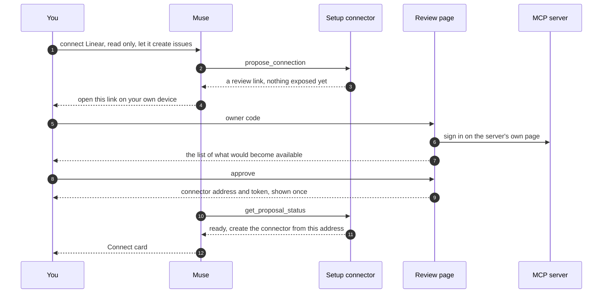

# Set up servers by chatting with Muse

Adding a server today means a terminal: register it, sign in, draft a policy, publish, then create the connector in Muse. Chat setup moves that into the conversation. You add **one** connector to Muse by hand, once. After that you tell Muse which servers to connect and what it may use, and the adapter turns that into the same published catalog it always enforces. The one thing Muse cannot do is approve its own request: you review it on a page of your own adapter.

It is off until you turn it on, and nothing changes for an adapter that does not.



## Turn it on

```bash
muse-vm chat-setup
```

Or turn it on while installing: `muse-vm setup --chat-setup` (or `chat_setup = true` in `muse-vm.toml`) installs the adapter, then does the same, and skips the question about which servers to connect, since you will ask Muse for them. Without the flag, `muse-vm setup` offers it at the end, and the answer is saved with your other choices.

This switches on the review pages, restarts the adapter, and prints two things, each **once**:

1. A sentence to give Muse, and a token. In a new Muse chat send the sentence, click **Connect**, and paste the token into Muse's own secure field. This is the only connector you add by hand.
2. Your **owner code**. Keep it in a password manager. You type it only on your adapter's own review pages, never into Muse.

Run `muse-vm chat-setup --rotate-owner-code` for a new owner code (the old one stops working and open review sessions end). Running the command again changes nothing else and prints no secret.

## Use it

Ask Muse in plain words, for example: *"Connect Linear. Read only, and let it create issues."* Muse looks the service up, then gives you a link. What happens next:

| Step | You do | Notes |
| --- | --- | --- |
| 1 | Open the link on your own phone or computer, and type your owner code | Not in Muse's browser. The code is checked by your adapter and never reaches Muse |
| 2 | Sign in to the service on its own page, or paste its token on the adapter's page | A service that needs no sign-in skips this. The token is stored encrypted and never shown to Muse |
| 3 | Read the list of what would become available, untick anything you do not want, then **Approve** | Nothing is exposed before this |
| 4 | In Muse click **Connect** and paste the connector token the page showed you | The page shows it once; it also offers a connection code |

A service that needs a sign-in shows you its tools only after you have signed in, so sign-in comes before review.

## What the review page shows

- **Your words, as Muse relayed them**, in a box marked as unverified. Judge by the list below them, not by the words.
- **The service**: its name and address, and whether it is in the adapter's own list. An address that Muse supplied and the adapter does not know carries a warning, and the adapter has not contacted it before you press the button.
- **What would become available**: each operation, whether it only reads, changes data, or may be hard to undo, how the adapter knows, and the server's own description in a collapsed block marked as the server's.
- **An alignment line**: how many things you asked for, how many would be available, and how many are available that you did not ask for. For a new connection that last number should be 0.
- **Whether the access is temporary**, and when it will end.
- **Limits on what an operation may be called with**, when you asked for them (*"only project ENG"*): shown under each operation they apply to, as *Limited by you to: project ENG*. They are enforced on every call; see [Limiting what goes into an operation](#limiting-what-goes-into-an-operation).
- **What the adapter does not enforce**: anything Muse said you asked for that it cannot hold to, such as asking you before each call or making access expire. It is listed as not enforced, so you are never left thinking it is in force. A limit that covers some operations but not another one that takes the same argument is listed here too (*get_issue takes project, which is limited on list_issues but is not limited on get_issue*). A limit that matched no operation or no argument is listed under *Could not be matched*, never dropped in silence.

You can untick any proposed operation, tick any other operation the server offers, and mark an operation that the server did not label read-only as read-only after you have checked it. Your choices are recorded.

## Why Muse cannot widen its own access

Muse reads web pages and messages written by other people, so what it says can be steered. The setup connector is built so that being steered cannot give it more.

- **The only operations it has** look things up, open a proposal, explain, and make access smaller. There is no operation that publishes, activates, links, stores a secret or widens anything. The connector's catalog is generated from code and pinned like any other.
- **A proposal changes nothing.** It is a record plus a link. The server is not contacted for an address the adapter does not know until you press the button.
- **The approval needs your owner code**, typed in a browser session. The setup connector's token opens nothing on the review pages. Five wrong codes lock that link for 15 minutes, and a stale or forged form is refused by a cross-site token.
- **Your approval covers exactly what you saw.** It is bound to a digest of the page. If anything differs, it is refused and you are asked to look again.
- **No secret goes through the chat.** No operation has a field for one, and a refusal does not repeat what was sent.
- **Text written by a service never reaches Muse before you approve.** Muse gets names and labels the adapter worked out. The service's own descriptions appear only on your page, marked as the service's.

Narrowing is allowed without you, because it can only reduce access: *"stop it creating issues"* switches that operation off at once, and *"disconnect Linear"* removes the connection. Anything that gives Muse more is a proposal you approve.

## Changing a connection later

Ask for more (*"also let it comment on issues"*) and Muse sends a change proposal. You review the new list the same way; the connector's address and token stay as they are. If Muse still lists old operations afterwards, ask it to refresh the connector. If the live policy changes while you are reviewing (for example Muse switched something off), the approval is refused and nothing is applied.

## Limiting what goes into an operation

Say *"Connect Linear, read only, and only project ENG."* Muse sends the limit with the request, as an argument and the values it may take, for one operation or for every operation that has that argument. You see it on the review page, you can still untick any operation, and when you approve it becomes part of the policy:

- **Every call is held to it.** A call whose value for that argument is not one of the allowed values is refused before the service is contacted. Leaving the argument out is refused too, so there is no way round it. A list of values is accepted only if every item is allowed, and a whole value must match, not part of it.
- **Muse is told.** The connector's description of the operation says what the owner limited it to, and the argument is marked required, so Muse asks for it instead of guessing.
- **Values or a pattern.** A limit is a list of values (`ENG`, `OPS`) or a short regular expression that the whole value must match. Patterns that can take very long to evaluate are refused.
- **A pattern is not got round by how a value is written.** A service may read a value differently from the pattern: `.../azure/../dotnet/` matches `.../azure/.*` and the service fetches the .NET pages. So when a pattern names a place (it contains a `/`), a value is also refused if, in any reading (as written, with Unicode folded, with each layer of percent-escapes removed), it carries a `.` or `..` path segment, a backslash, an encoded dot or slash, or a control character. A pattern with no `/` refuses control characters only. A list of values is matched exactly and needs no such check.
- **Only declared arguments.** An operation with a limit takes only the arguments its schema declares (unless the schema says it takes more), so a made-up name cannot say the same thing as the limited one.
- **Limits only get tighter on their own.** *"Actually only ENG"* (fewer values than before) and *"also limit get_issue"* are applied at once by `limit_arguments`, as with switching an operation off. Allowing more values, or anything the adapter cannot prove is no wider, is a change you approve like any other.
- **A new operation starts without limits.** If you later add an operation, it does not inherit limits from the others, and the review page says so. Ask for the limit again if you want it.
- **If the service redefines an operation**, its limits stay while the argument still exists. If the argument is gone, the page tells you the limit went with it.

It limits what Muse can send, not what the service does with it: a value like `ENG` is only as meaningful as the service's own handling of it.

## Access that ends

Say *"Connect Linear for the next two hours."* Muse sends the time with the request, and the review page says *Access is temporary: it ends 2 hours after you approve*. The two hours start when you press **Approve**, not when Muse asked, and you are shown the exact end on the approved page.

- **It ends by itself.** From that moment every call is refused with a message that says the access ended and when, the operations disappear from what Muse reads when it refreshes the connector, and `list_connections` marks them as ended so Muse can tell you. Nothing needs to run for this to happen: each call checks the time.
- **Anything already in progress** that asks Muse a question is not resumed after the end either.
- **Adding to the connection does not extend it.** If you later approve another operation for a connection that ends at 13:00, the new operation ends at 13:00 too.
- **Extending is your decision.** *"Give it five more hours"* is a change you review and approve; the new end replaces the old one for every operation of that connection, counted from that approval.
- **Ending sooner needs nobody.** *"Stop it in an hour"* is applied at once (`expire_access`), like switching an operation off; it can only bring the end closer.
- **At most 30 days.** For anything longer, do not ask for an end.

The clock is the adapter's own, so it holds as long as the machine's time is right.

## What it can and cannot enforce

| Can enforce | Cannot yet |
| --- | --- |
| Which operations exist for Muse | Asking you before each call |
| What values an operation may be called with (only one project, only these recipients) | Limits that depend on the contents of a request (for example how many records it touches) |
| Access that ends at a time you approve | Servers that run only on your own machine (`stdio`) |
| Read, write or sensitive write, with writes marked for Muse to confirm and run once | |
| Timeouts and result sizes you ask for | |
| Nothing exposed unless you asked | |

## Which services Muse can look up by name

The adapter carries a list of about 34 services run by their vendors (Linear, GitHub, Atlassian, Sentry, Notion, Slack, Stripe, Supabase and others) with each one's official address and how it signs in. For those Muse needs no address, and the review page does not warn you about the address. For anything else Muse gives an address, the page warns you that it is not in the list, and nothing contacts it until you press the button. Servers that run only on your own machine (`stdio`) cannot be used.

How you sign in depends on the service, and Muse is told which before it asks:

| The service | What you do on the review page |
| --- | --- |
| Needs no sign-in (documentation and search servers) | Nothing: press **Look at what it offers** |
| Lets programs register themselves (most do: Linear, Sentry, Notion, Supabase, ...) | Sign in once on the service's own page |
| Wants a token (GitHub) | Paste the token on the page. It is stored encrypted and never shown to Muse |
| Only signs in through an app you register first (Slack, Asana, HubSpot) | Register an app in the service's developer settings with the redirect address the page shows, paste its **client ID** and **client secret** on the page, then sign in on the service's own page |

The client secret is stored encrypted on your machine, used only to sign in as your app, and forgotten when you cancel the request or remove the connection. If you typed the wrong details, press **Cancel this request** on the page and ask Muse to start again. A request can also be cancelled while you are still looking at the first page, which tells Muse not to ask again.

The list is generated from the [MCP Compat](https://github.com/sept-usc/mcp-compat) catalog with `scripts/generate_directory.py`; a handful of entries are written by hand and take precedence. A service that signs in only with a client ID metadata document is not in the list yet.

## The record

Every step is written to the administrative audit, and each row carries a hash of the row before it, so an edited, removed or inserted row breaks the chain. The runtime audit already records which catalog version answered every call. Together they let you walk from any call back to the words you approved.

On the machine, with the adapter's commands:

```bash
docker compose exec adapter muse-mcp-adapter --database /data/adapter.db --config /config/serve.json proposals
docker compose exec adapter muse-mcp-adapter --database /data/adapter.db --config /config/serve.json audit-verify
docker compose exec adapter muse-mcp-adapter --database /data/adapter.db --config /config/serve.json explain-call --request-id REQUEST_ID
docker compose exec adapter muse-mcp-adapter --database /data/adapter.db --config /config/serve.json explain-change --proposal-id PROPOSAL_ID
```

`proposals` lists what is waiting. `audit-verify` checks the chain and fails loudly where it is broken. Note the head hash it prints somewhere else; later, `audit-verify --head HASH` also fails if that hash is no longer in the chain, which is what shows rows that existed then were cut off the end, and tells you how many rows came after it. `explain-call` follows a call to its catalog version, the proposal behind it, your words and your approval. `explain-change` prints one proposal's record. If a link is lost or locked, `proposal-link --proposal-id ID` prints a fresh one and ends the old one.

## Limits and honest notes

- **The owner code is a typed secret.** A look-alike page could ask for it. Only type it on your adapter's own address, which every review page shows at the top. Passkeys would remove this weakness and are not built yet.
- **Muse's own prompts are not relied on.** Whether Muse asks before it calls a write is Muse's behaviour; the approval here does not depend on it.
- **The audit chain detects edits and removals, not an attacker who rebuilds it.** Anyone with root on the machine already holds the adapter's keys; pin the head hash elsewhere.
- **Muse still has two steps of its own**: creating the connector and entering its token.
- **The service's own account is yours.** What Muse can do through a connection is limited by the operations you approved and by the permissions of the account or token you gave the adapter. Give a token only the access the connection needs.
