# Connect GitHub to Muse with a scoped token

This is the whole path for giving Muse access to one GitHub repository through the adapter, from creating the token to using the connector, widening it and removing it. Muse gets only what you approve, never sees your GitHub token, and the access can end by itself.

It uses [chat setup](chat-setup.md). If you have not turned it on, run `muse-vm setup --chat-setup` (see [getting started](getting-started.md)), or `muse-vm chat-setup` on an adapter that already runs.

  

## Before you start

- The adapter is running with chat setup on, and you added its **setup connector** to Muse once (the sentence and token that `setup` printed).
- You have your **owner password**, or the generated owner code. To choose a password you can remember, run `muse-vm chat-setup --set-owner-password`. You type it only on your adapter's own review pages, never into Muse.

## 1. Create a GitHub token for one repository

Make a [fine-grained token](https://github.com/settings/personal-access-tokens/new) limited to the repository Muse should use. Read access to issues and pull requests is enough to start; add write access for Issues and Pull requests later if you want Muse to change things. The adapter's access can never exceed what this token allows, so keep it as narrow as the task.

## 2. Ask Muse in plain words

For example:

> Create a GitHub connector for the repository OWNER/REPO. It should read and commit, open pull requests and create issues, but not delete anything, and not create or delete branches. Access for three hours.

Muse is told not to guess GitHub's tool names. It sends the service and your words, and gives you a **review link**. Nothing is exposed yet.

## 3. Open the link on your own device

Open it on your phone or computer, not in Muse's browser. Type your owner password. This signs you in for 30 minutes so you can read the page. It does not approve anything.

## 4. Give the adapter the token

Paste the GitHub token on the page. It is stored encrypted on your machine and is never shown to Muse. The adapter then asks GitHub what it offers, using your token, and freezes the answer as an immutable, hashed snapshot. That snapshot is the service's truth for everything that follows.

## 5. Let Muse draft the policy

Tell Muse you are on the review page. It reads the snapshot with `get_service_details`: every tool with its argument names, types and allowed values, plus resources and prompts. It then drafts the smallest policy that does what you asked, with `revise_proposal`: exact names, a short reason for each operation, and the end time. If you asked for one repository, it can limit the operations that take a repository to that value.

If nothing is selected yet, the page says Muse has not drafted anything and refuses to approve an empty proposal.

## 6. Review the summary and approve

Reload the page. Operations that change data come first, each with Muse's reason (marked as Muse's and unverified), and the reads are folded below. Untick anything you do not want. Check the line that says how many operations you asked for and how many would be available.

Type your owner password again and press **Approve**. The password is asked every time, whether this is a first connection or a widening, and a wrong one is counted: five wrong passwords lock that link for a while.

## 7. Connect it in Muse

The page now shows the connector address and the **connector token, once**. In Muse, create the connector from that address, click **Connect**, and paste the token into Muse's own secure field. Muse says it is connected. If you lose the token, `muse-vm rotate-token github` issues a new one.

## 8. Use it, and see what is refused

| You say | What happens |
| --- | --- |
| *List the open issues in OWNER/REPO.* | Real data |
| *List the open issues in SOMEONE/ELSE.* | Refused, if a limit to one repository was approved |
| *Delete that branch.* | Refused: no operation that does it was approved |
| (after the three hours) any call | Refused, with a message that says the access ended and when |

## 9. Widen it one operation at a time

When a task needs something that is not allowed, Muse looks at what exists but is not allowed, then asks for only that operation, with a reason. You get a new review link that shows only what is new, in its own section. You approve it with your password. The connector address and token stay as they are; if Muse still lists old operations, ask it to refresh the connector.

## 10. Make it smaller, or remove it

Muse can make access smaller without a page, because that can only reduce what it can do: *"stop it creating issues"*, *"only repository OWNER/REPO"*, *"end the access in an hour"*, *"disconnect GitHub"*. Remove the GitHub token from your GitHub settings when you are done with it.

## What this does not do

- It does not stop Muse using its other tools, such as its own browser. Limit those in Muse.
- A limit reaches tools only, not prompts or address templates. The review page lists what is not enforced.
- The adapter cannot ask you before each call; Muse's own confirmation is separate.

Next: [how the whole flow works and why Muse cannot widen its own access](chat-setup.md) · [every credential](authentication.md) · [troubleshooting](troubleshooting.md)
