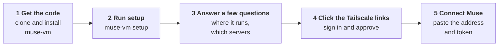

# Getting started

The guided setup from the [README](../README.md#get-started), explained step by step. It takes about 5 to 10 minutes.

## Overview

`muse-vm setup` is a guided run. It checks that everything is in place, asks where the adapter should run, creates it, opens the Tailscale link you need to click, lets you pick the MCP servers Muse should use, and prints what to give Muse. It asks only for what it cannot work out itself, and it takes about 5 to 10 minutes, most of it building.

**What you will do:** say where it runs, click one Tailscale sign-in link (a second approval appears only the first time your Tailscale network uses Funnel), and pick your servers, pasting a token for any that need one. Nothing to prepare in the Tailscale console, no domain, no open ports, no auth key.

| Where it runs | How | What happens |
| --- | --- | --- |
| **A new Google Cloud VM** | `muse-vm setup`, or the Cloud Shell button in the README | A network of its own, a shielded VM with no public IP, SSH only through Identity-Aware Proxy, daily snapshots |
| **A Linux machine you already have** | `muse-vm setup --ssh user@host` | Only what is missing is installed (Docker, automatic security updates); an existing Docker is never restarted |
| **The machine you are logged in to** | [`install.sh --local`](#installing-from-the-vm-itself) | The same setup, run on the VM itself |

Whichever you pick, the end state is the same: a public HTTPS address through Tailscale Funnel, nothing on the machine accepting inbound connections, and a self-check of eleven tests run from outside and inside before it reports success.

**It is safe to run again.** If anything stops half way, run `muse-vm setup` again: an existing deployment is kept, a server that never finished connecting is finished, and a corrected token replaces the rejected one. Your own MCP server can be added by pasting its address when `setup` lists the servers, or later with [`muse-vm add-server`](automation.md#settings-file-and-automation).


## The steps



### Step 1 · Get the code

```bash
pipx install git+https://github.com/sept-usc/muse-mcp-adapter
```

**What this does.** It installs the `muse-vm` command. The adapter itself is built later, on the machine, from the code that came with the install: the container recipe, the hash-locked dependency list and the egress guard all travel inside the package, so there is nothing else to download. `muse-vm` records which release the images were built from.

**To review and pin the code first** (recommended for production), clone it and install from your checkout instead:

```bash
git clone https://github.com/sept-usc/muse-mcp-adapter
cd muse-mcp-adapter
git checkout <the tag or commit you have reviewed>
python3 -m venv .venv && .venv/bin/python -m pip install .
```

From a checkout, `muse-vm` builds from that checkout and records the commit. It refuses to deploy a checkout with uncommitted changes (`--allow-dirty` overrides), so every deployment matches a commit you can name again. In the examples below, `muse-vm` is `.venv/bin/muse-vm` in that case.

**Not sure everything is in place?** Run `muse-vm doctor` first. It checks Python, `ssh`, what the images will be built from, and (if you use Google Cloud) that `gcloud` is signed in with valid credentials and a project, and tells you how to fix anything that is missing, before anything is created.

### Step 2 · Run setup

```bash
.venv/bin/muse-vm setup
```

`setup` works through these stages. Each is an ordinary `muse-vm` command, so nothing happens that you could not do by hand.

| Stage | What you do | What happens |
|---|---|---|
| **Where** | Pick *a new Google Cloud VM* or *a Linux machine I already have*. If `gcloud` is signed in, your project is already chosen for you. For your own machine, type its SSH address (`user@host`). | It shows what the choice costs, and asks before creating anything billable. |
| **Check** | Nothing. | The doctor runs against the target: tools, credentials, SSH and `sudo`, a supported Linux, reachability of Docker Hub and PyPI. If something is wrong it says what and how to fix it, and stops before creating anything. |
| **Create** | Click the Tailscale links (next section). | Google Cloud: a network of its own, a shielded VM with no service account and no public IP, SSH only through Identity-Aware Proxy, daily snapshots. Your own machine: only what is missing is installed (an existing Docker is never restarted). Then the images are built from your checkout and the adapter starts. A self-check tests it from outside and inside. |
| **Servers** | Choose from the well-known servers by number or name, paste the address of your own, or press Enter to skip. Paste a token if a server needs one. | Each server is connected, its tools are discovered, and only the read-only ones are exposed. You get a connector address and token for each. |
| **Save** | Say yes to save your answers. | They are written to `muse-vm.toml` (no secrets in it), so the next run needs no questions. |

**The Tailscale links.** Tailscale gives the adapter its public HTTPS address (`https://<name>.<your-tailnet>.ts.net`) without opening a single port, owning a domain, or giving the machine a public IP. There is nothing to prepare in the Tailscale console: during **Create**, `muse-vm` opens up to two links in your browser. The first signs the machine in to your Tailscale account. The second, shown only if your tailnet has not used Funnel before, is Tailscale's own one-click approval for HTTPS certificates and Funnel. Click approve in each and the run carries on by itself. If your tailnet requires device approval, approve the new device under Machines.

**Which servers?** `muse-vm presets` lists them: Microsoft Learn (no sign-in), GitHub (a token), Linear and Atlassian (you approve access in your browser). Any other MCP server works too: `muse-vm add-server myserver --endpoint https://…`.

**Tokens.** A token is typed at a hidden prompt on your computer and stored in a root-only folder on the machine. It never appears in a command line, a log or a database. For GitHub, create a [fine-grained token](https://github.com/settings/personal-access-tokens/new) limited to the repositories Muse should use; read access is enough to start.

**You will know it worked when** `setup` ends with `The adapter is running at https://…`, eleven green checks during Create, and a connector address for each server.

### Installing from the VM itself

If you would rather log in to the Linux VM and run everything there, with no second computer involved:

```bash
curl -fsSL https://raw.githubusercontent.com/sept-usc/muse-mcp-adapter/main/scripts/install.sh -o install.sh
less install.sh              # it is short: read it before you run it
bash install.sh --local
```

It needs a Debian or Ubuntu VM, a user with passwordless `sudo` (or root), and outbound HTTPS. The installer puts `muse-vm` in your home directory (fetching a suitable Python itself if the VM's is too old), then runs the same guided setup against this machine: only what is missing is installed, and an existing Docker is never restarted. The Tailscale links are printed in the terminal, so open them in your own browser. The same script is what the Google Cloud Shell button uses.

### Step 3 · Connect Muse and try it

1. Open a **new side chat** in Muse (not your main chat) and send: `Create a connector called GitHub from the API spec at <the connector address>`.
2. Muse reads the API description and shows a **Connect** card. Click **Connect** and accept Muse's consent dialog.
3. Paste the **token** when Muse asks. (Or, if Muse offers it, sign in with the **connection code**.)
4. Muse says the connector is connected. Try it:
   - *"List the open pull requests in my repository `<owner>/<repo>`."* (a read)
   - *"Create an issue titled 'test' in that repository."* (a write; only if you allowed writes, below)

**You will know it worked when** Muse answers with real data and `muse-vm logs` shows the matching `POST …/operations/<name> 200` lines.

### Letting Muse change things

Writes are never exposed by default. To let Muse use specific write tools, publish a new version:

```bash
.venv/bin/muse-vm expose github --allow issue_write --allow add_issue_comment --allow create_pull_request
```

It adds exactly those tools; everything already published keeps its settings, and the connector address and token do not change. Use `--deny TOOL` to withdraw one. Muse asks you before it calls a write, and the adapter runs each write once: if it cannot tell whether a write happened, it marks it `UNKNOWN` and never retries it blindly. See [Stay in control](policy.md#stay-in-control-your-policy).
