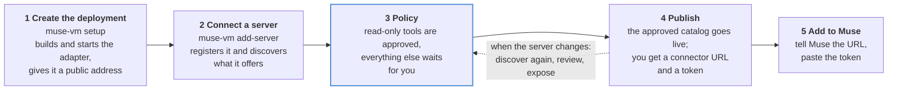
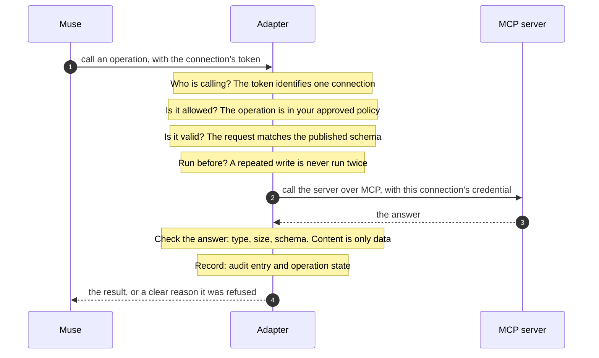

# How it works

## What you can use it for

- **Look things up from Muse.** Connect a documentation or knowledge server, such as Microsoft Learn, and Muse can search official documentation and read whole pages while you chat. Ask "How do I raise the function timeout for Azure Functions on the Consumption plan?" and Muse searches, then answers from the real documentation.
- **Work with your tools through chat.** Connect an issue tracker, a wiki, or a database server, such as Linear or Atlassian, so Muse can read records and, with your confirmation, change them. Every write is marked, confirmed with you first, and runs once.
- **Share only part of a server.** A server may offer dozens of tools. Publish just the read-only ones, or just the three you need, and the rest do not exist for Muse.
- **Bring your own MCP servers to Muse.** Any MCP server, including one you wrote, becomes a Muse connector. You do not hand-write an API description or build a separate connector for each tool.
- **Keep credentials out of Muse.** Muse holds one revocable token per connector. The keys and sign-ins for the MCP servers stay inside the adapter.
- **Stay in control as servers change.** When a server adds, removes, or alters a tool, you see the difference and decide whether Muse gets it.
- **See what Muse did.** Every call is recorded with its operation, outcome, and duration, and a write's state is tracked until it is settled.

## From setup to a call

1. **You run the adapter on a small Linux machine you control.** One guided command, `muse-vm setup`, builds it from the release you installed (or your checkout) and starts it. The machine gets a public HTTPS address through Tailscale Funnel, and nothing on it accepts inbound connections.
2. **You connect an MCP server.** `muse-vm add-server` registers the server, looks at what it offers, and drafts a policy that exposes only its read-only tools. You decide whether to expose more.
3. **You add the connector to Muse.** You give Muse a connector address and a token. Muse reads the API description and can now use the tools you approved.
4. **Every call is checked.** When Muse calls a tool, the adapter confirms who is calling, that the operation is on your list, and that the input is valid. It then calls the MCP server with its own credential, checks the answer, records the call, and replies.

You run the adapter in your own environment, on your own machine and with your own accounts. There is no shared service in the middle, and no one else holds your credentials.

## Key concepts

| Term | What it means |
| --- | --- |
| **Server** | An MCP server you register by its address, such as Microsoft Learn or Linear. |
| **Policy** | Your list of what Muse may use. Anything not on it does not exist for Muse. |
| **Catalog** | The approved, versioned result of your policy. This is what Muse sees, and you can roll back to an earlier version. |
| **Connection** | One link between Muse and **one** MCP server: its own connector URL, token, policy, and credential. Add a second server and you get a second connection. It is a record inside the adapter, not a separate program, so one adapter process holds as many connections as you create. |
| **Connector URL** | The address you give Muse for a connection. Its random part only keeps the address private and routes the request to the right connection. It is not the security: every call still needs the connection's token. |
