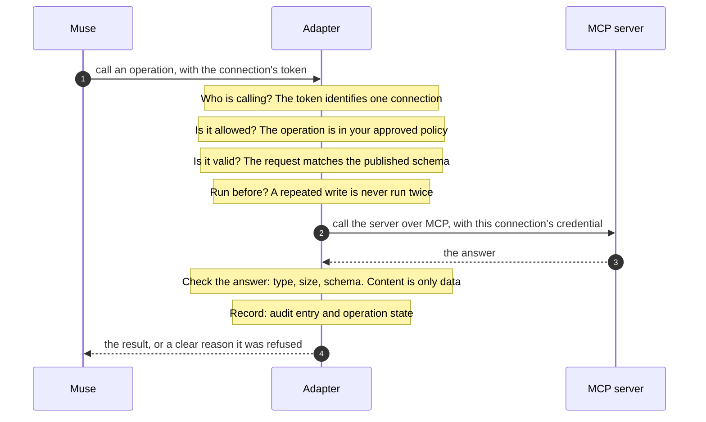

# Stay in control: your policy

`policy-template` drafts a policy from what the server offers. It starts closed: `--expose-reads` pre-approves everything read-only (tools the server marks read-only, plus its resources and prompts), and writes always start switched off. You edit the file, and only entries with `"allowed": true` are exposed.

| You decide | Field | Default |
| --- | --- | --- |
| Is it exposed to Muse? | `allowed` | No |
| Read, write, or sensitive write? | `classification` | Write, unless the server marks the tool read-only (`add-server` then drafts it as a read; add `--no-reads` to review it first) |
| What Muse is told about it | `description` | The server's text, pinned at publish so the server cannot change it later |
| The name Muse sees | `publicOperationId` | Derived from the tool's name |
| How long and how large | `timeoutSeconds`, `maxResultBytes` | 30 seconds, 256 KB |
| Which resources and arguments | `resource` block (`allowedUriSchemes`, `argumentPatterns`, ...) | Strict |

A single entry, taken from a real Microsoft Learn policy:

```json
{
  "primitiveKey": "tool:microsoft_docs_search",
  "allowed": true,
  "publicOperationId": "microsoft_docs_search",
  "classification": "read",
  "description": "Search official Microsoft/Azure documentation ...",
  "timeoutSeconds": 30,
  "maxResultBytes": 262144
}
```

The adapter enforces this on every request:



If the server changes later, run `discover-remote` again and then `drift` to see what was added, removed, or altered. Muse keeps seeing the published catalog until you review the change and publish a new version, and `rollback` returns to the previous one. See the [policy reference](usage.md#2-policy-file) for every field.
